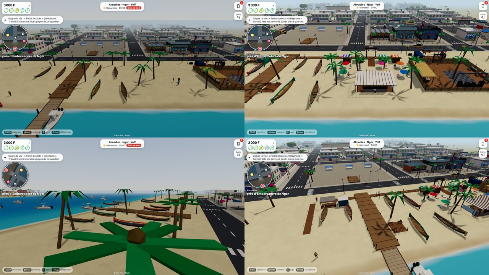

# La plage de Ngor — the beach first, then the embarkation

The owner's request (27 Oct 2026, going to sleep): « Change the embarkation of the island of Ngor to a beach side first, then you get the embarkation area; the beach of Ngor is famous in Dakar. … I want to go to the beach of Ngor, walk around, buy stuff, lie on a beach bed, then go and see the embarkation and watch the island. » (and, for the nightlife street and bars, « the changed architecture with a modern feel »: that is PR zayd95/dakar-rek#77, `docs/districts/M4-STRIP-PLACEMAKING.md`.)

**Status: Gate A (engineering) only. No iPhone has run this.**

## The walk
Coming east along the Almadies' coast from La Vague, the player now meets the beach first; the embarkation is at the far end of it. Hub-local metres, north (the sea) is −z.

| Where | What |
|---|---|
| Road side, x −8 | The gate « PLAGE DE NGOR » over a timber spine to the sand. |
| z −130.4, x −22 … 47 | **The boardwalk**: a deck along the sand with low light posts, running east over the pier's foot to the embarkation. A signboard at x 24: « Plage · Transats · Bar · Embarcadère → Île de Ngor ». |
| z −134, x −18 … 3 | **Four stalls**: *Lunettes & chapeaux*, *Coco frais · jus*, *Maïs grillé · beignets*, *Wax · colliers · art* (striped canopies, goods, a sign, the stallholder behind the counter). |
| z −139 and −145, x −21 … 4 | **Twelve sun beds** under colourful parasols, head to the land and feet to the sea. |
| x −14 … −3, z −153 … −147 | **Ngor Beach Lounge**: a modern timber-and-concrete bar with a flat roof, slat fins, glass wind screens, stools facing the sea, a lounge, surfboards on a rack (Ngor is a surf beach). |
| x 36 … 47, z −136 … −130 | **The embarkation**: the ticket hut (« Billets · pirogue & chaloupe · île de Ngor »), a rack of orange life jackets, a waiting shelter with benches, a plank path (x 49.5) down to the boarding beach where the pirogue and the chaloupe wait (the traversée, unchanged). |
| x 22 … 27, z −154 … −149 | **The lookout deck** beside the pier: a telescope on the island, two benches facing the sea. |

## What the player does (existing activities only: no new money path, no schema change)
- **Buy:** sunglasses 3 000 F, a straw hat 2 500 F, a wax cloth 8 000 F, a necklace 1 500 F, a small painting 6 000 F; coconut water 500 F, bissap 300 F, ginger juice 400 F; grilled corn 300 F, beignets 500 F, peanuts 200 F; at the lounge bar a lemonade, mint tea, Café Touba, grilled fish with rice (6 000 F, eaten at the stools), prawn skewers. Stalls 8 h–20 h, the bar 10 h–2 h (closed: the shop says when it opens).
- **Lie on a sun bed:** « Louer un transat » 500 F: the player lies down (the Lie pose), the camera goes behind their feet to the sea and the island, energy and mood rise. The bed is also an ordinary seat (« S'asseoir »).
- **The embarkation:** a word with the guichet (the departures, what to see on the island), the shelter's benches; the crossing itself is the traversée's (`src/venues/embarcadere.ts`), unchanged.
- **Watch the island:** « Regarder l'île de Ngor » at the telescope: the camera looks across the bay at the island's village, red and ochre roofs, the beach parasols and « Sunu Toit »'s terrace.
- **The day's card:** once a day, when the day had a purchase, a rest on a bed and a look at the island: « Ta première journée à la plage de Ngor » (`ng_` counters only).
- **People:** stallholders, the barman, the guichetier, and sunbathers, drinkers, people waiting and a bench-sitter by the day: the reusable crowd's instanced figures (`src/crowd/crowd.ts`, two draw calls for all, never a full body: the first version used full bodies and doubled the draw calls).

## Code
- `src/world/ngorBeach.ts`: the geometry (merged batches, colliders, the poses and anchors `NGOR_BEACH`, the seats `ngorBeachSeats()`, the keep-clear rectangles). Reuses the strip's parts (`src/world/hospitalityStrip.ts`: palms, planters, festoons, lamps). No draw from the generator's random stream.
- `src/venues/ngorBeach.ts`: the place (anchors, offers), the people, the day's card, the camera.
- Two lines in LD2.0's files (CONTRACT row 16): `src/world/builder.ts` (the `port` special) and `src/venues/index.ts`.
- Tests: `tests/ngorBeach.test.ts` (seats; every anchor reachable; nothing in the traversée's zones; the boardwalk unobstructed over the pier's foot; the lookout reachable round the beach palm), `tests/boats.test.ts` (LD2.0's, unchanged: it caught the first shelter standing in the open way to the boarding beach), the villa fixture retaken. Real touch: `scripts/check-ngor-beach.mjs`. Perf: `scripts/ngor-views.mjs`.

## Evidence
See the results block at the end of this file.

## Not done / honest limits
- **No iPhone**; Chromium with touch emulation (SwiftShader).
- **The beachgoers sit up** on the beds (the crowd has no lying pose); only the player lies down. They do not walk.
- **No new rule for the island's own beach**: the player still cannot step onto the island (`docs/TRAVERSEE.md`).
- The shop goods are things you buy with a line and a counter, not items in a bag: they count toward the day's card and the mood, they do not appear in the inventory.
- Prices and names are invented.

## Results (Chromium, touch emulation, SwiftShader; logs and pictures in [`proof/ngor/`](proof/ngor/))
Before / after, the beach seen from the sea (left: the integration branch, right: this one): 

- **The beach, played with real touch** ([`journey.log`](proof/ngor/journey.log), [video, 3 min](proof/ngor/journey.mp4)): along the boardwalk → coconut water (500 F paid once) → sunglasses (3 000 F, counted) → a rented sun bed, the player lies on it with the camera on the sea (500 F paid once, energy and mood up) → the embarkation, the guichet's answers → the lookout deck, the telescope, the camera on the island → the day's card: **16/16**.
- **The traversée, unchanged** (LD2.0's `scripts/check-traversee.mjs`, [`traversee.log`](proof/ngor/traversee.log)): **37/37**.
- **The rest of the Almadies still works** on this branch: the M4 evening journey **40/40** ([log](proof/ngor/m4-journey.log)), the villa street check **43/43** ([log](proof/ngor/villa-street.log)), the car park drive-in ([log](proof/ngor/carpark.log)).
- **Unit tests:** `tsc` clean; the full suite **2863 passed**, 3 skipped (222 files), including `tests/ngorBeach.test.ts` (6), LD2.0's `tests/boats.test.ts` (clear zones) and the retaken villa fixture.
- **Performance** (`scripts/ngor-views.mjs`; draw calls / triangles of one frame at four views on the beach, before → after; budget 300 calls; [`views-before.json`](proof/ngor/views-before.json), [`views-after.json`](proof/ngor/views-after.json)):

| View | Low | Medium |
|---|---|---|
| Boardwalk and stalls | 53 / 98 054 → 67 / 110 912 | 47 / 128 016 → 59 / 137 698 |
| Sun beds | 33 / 83 616 → 36 / 92 054 | 42 / 123 156 → 84 / 156 174 |
| Embarkation | 36 / 86 280 → 40 / 94 714 | 37 / 118 538 → 62 / 141 686 |
| Lookout, the island | 34 / 85 070 → 36 / 93 408 | 37 / 119 276 → 38 / 128 130 |

  The extra calls are the nine sign boards and, on Medium, full bodies of the city's own passers-by, who now come and sit on the beds and the bar's stools (the shared crowd's budget, four at most on Medium). Headless counts, not frame times: **the iPhone may feel the +10 000 to +33 000 triangles on Medium; that is for the owner's playtest.**
