# Mobile reference-character candidate

This is one new playable reconstruction of the uploaded low-poly, Sims-inspired reference. Enable it
with `?reference-character&touch&reference-hour=9` for a daylight review (omit the hour to use the live city clock).
It runs in the existing city, with a closer 6.5 m outdoor camera,
one fixed cream/teal outfit, articulated five-finger hands and a new human face/hair silhouette.
The default game and NPC population keep the integration character while this art candidate is reviewed.

Base: current `integration/living-dakar` at `0cbf0d410cdf1ed891cd340c359b90ddfb9075ff`, rechecked before
publication. `release` remains `f2335f177f2b8f56b9d3ce3bb83d4e583888b121` (merged PR #24). Existing
football/seated-meal divergence and completed older PRs were not imported into this character work.

## Before / after: actual mobile game

Before uses a pinned export of that integration commit. Same 390×844 viewport, low quality, location,
camera distances/angles and morning lighting; captures have no retouching. The street views show the
follow-camera change, while the other views use identical close-up cameras. Live calendar and NPCs may vary.

| View | Current integration | Reference candidate |
| --- | --- | --- |
| Face / upper body |  |  |
| Human proportions |  |  |
| Hands |  |  |
| Normal street camera |  |  |

| Motion / seating | Candidate capture |
| --- | --- |
| Walk |  |
| Jog |  |
| Sprint |  |
| Left quarter-turn |  |
| Right quarter-turn | 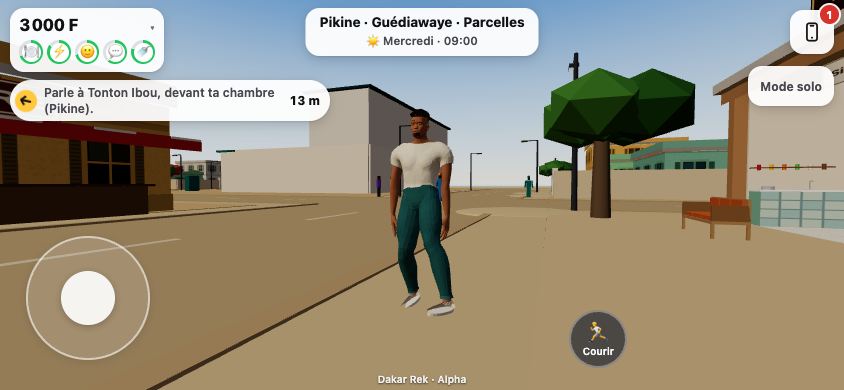 |
| Actual city bench |  |

Matching landscape before/after, side profiles and additional motion captures are in
`screenshots/reference-character`. [Browser results](screenshots/reference-character/results.json).

### Seated hand refinement

The first reference candidate held its hands above the abdomen. The new retarget rests both palms
on the thighs and lifts them slightly while sitting down or standing up to clear the trousers.
Same mobile camera, bench and morning lighting below; the live calendar/HUD may differ.
Before is the initial reference candidate at `b891586`, not V4.

| Initial reference candidate | Relaxed lap contact |
| --- | --- |
| 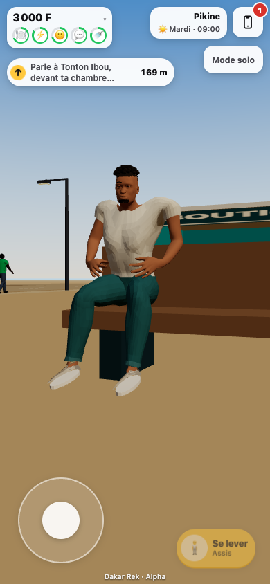 |  |

[Refinement browser results](screenshots/reference-character/seated-hands/results.json).

### Directional turns and capture calibration

Standing turns now select a left or right stepping clip from the actual signed facing change. The
right CMU capture is calibrated using its nonzero spine joint; the old zero-offset joint could not
define facing. The left clip mirrors the calibrated deformation onto the opposite limbs.
Playback holds each turn and sit/stand transition on its final frame instead of looping it.

The turn comparison below uses the same camera, location and morning lighting. Before is
the previous reference candidate at `2092f43`, whose single stepping clip was used for both directions.

| Previous turn | Calibrated turn |
| --- | --- |
| 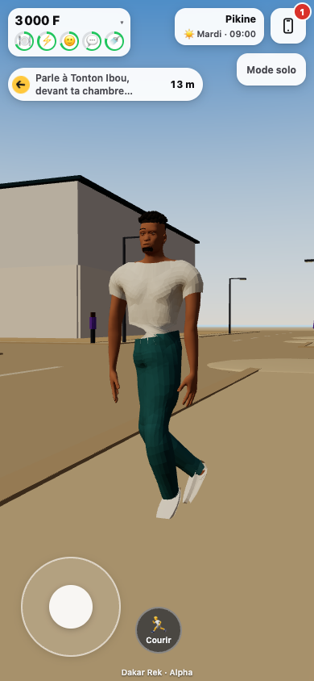 | 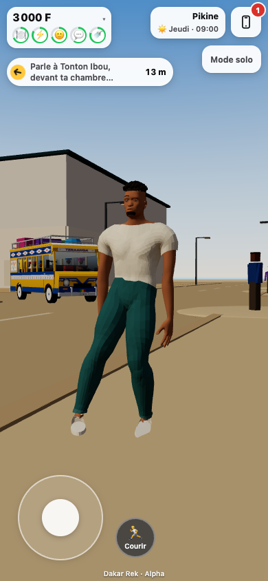 |

[Both-direction mobile results](screenshots/reference-character/directional-turns/results.json).

### Standing up without the jump

Previously, pressing **Se lever** moved the player 0.85 m away from the bench while the body was still
seated. Ordinary reference-character seats now keep their occupant while the captured rise eases toward
the existing collision-safe stand spot. The first-frame displacement is 0 m; the largest measured step
is 2.53 cm at 60 Hz. Joystick movement interrupts on its first frame, repeated taps do not restart the
rise, and travel clears it. The seat is released when the player stands or interrupts the motion.
The licensed sit/stand clips also use measured sole contact to remove up to 6 cm of foot float.

Matched 390×844 mobile camera, bench and morning lighting; before is `4ef1322`.

| Previous stand start | Connected rise |
| --- | --- |
| 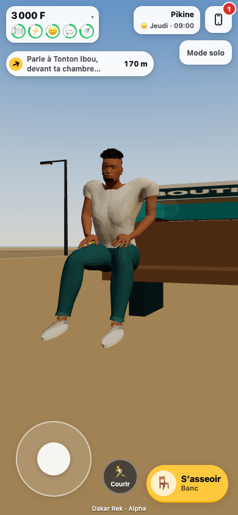 | 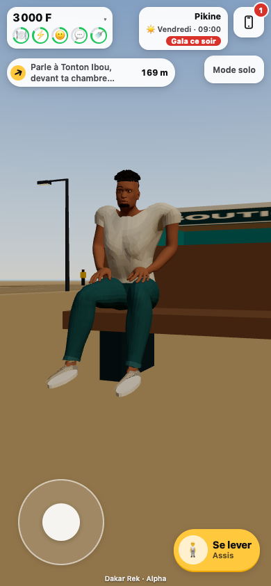 |
| 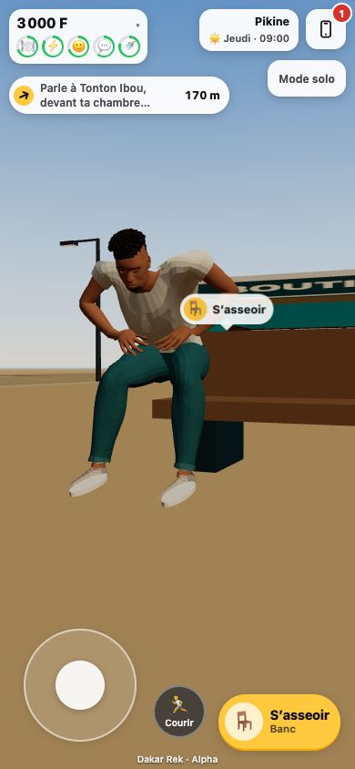 | 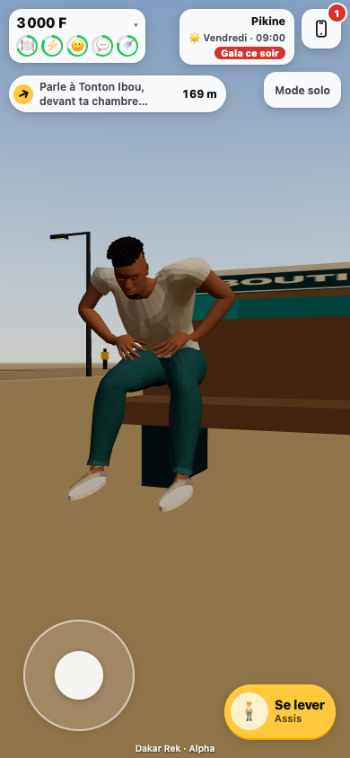 |

[Both-orientation rise/control checks](screenshots/reference-character/stand-up/results.json).

### Nearby labels leave the character clear

After standing, the bench's **S’asseoir** bubble crossed the character's torso in both phone orientations.
The reference preview now hides a world label immediately when it overlaps the projected body; the
primary action remains available under the thumb. Clear labels stay fully inside the screen with an
8 px margin, including the previously cut-off side view. Placement uses eight conservative bounds
corners and cached label dimensions, without per-frame skinning, raycasts or layout reads.

Matched camera, bench and morning lighting; before is `c8b9a28`. Model and motion are unchanged.

| Previous label | Clear character / readable label |
| --- | --- |
| 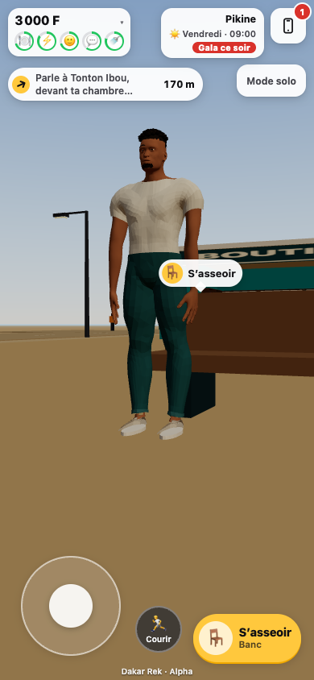 | 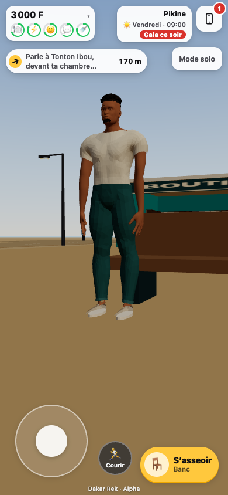 |
| 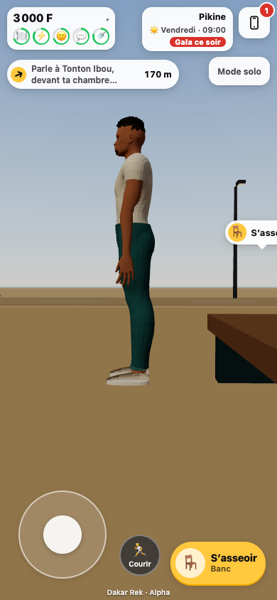 |  |

[Both-orientation label/touch checks](screenshots/reference-character/prompts/after/results.json) verify
front, side and back views against the actual deformed mesh, and use the real touch action to sit again.

## Asset and motion

The source is fresh licensed MakeHuman anatomy, a fitted CC0 garment, new authored hair/face details,
cuffs and sneakers. It does not import V4/V6 geometry or apply V4's face/gait corrections. Full licensing,
input hashes, reconstruction parameters, Blender source and rebuild steps are in
[the source register](../assets-src/reference-character/README.md).

| Mobile asset check | Result |
| --- | --- |
| Exported GLB | 2.00 MB, no bitmap textures; below the 2.5 MB asset cap |
| Geometry | 18,067 triangles; one skinned mesh/material |
| Rig | 52 bones, including three weighted joints per finger |
| Stature | 1.78 m anatomical source, human proportions |
| Requested motion | Idle, walk, jog, sprint, captured left/right quarter-turns, sit; one-shot sit/stand transitions |

Quaternius motion and CMU captures are retargeted to this rig. The relaxed idle closes a three-second
loop; locomotion adapts stride to human legs, preserves the captured knee pole/foot orientation, and
retimes from measured sole speed. Actual stable cadence is about 135 / 166 / 204 steps per minute at
the existing 2 / 4.2 / 7 m/s speeds. Physics owns horizontal travel. The reference player's soles align
with the actual road/sidewalk/block heights instead of floating at the legacy body's origin.

Bench fitting uses butt contact at the existing 0.48 m seat offset, with this rig's pelvis at 0.62 m.
The preview profile retains nickname editing but offers no appearance swatches or character creator.

## Verification

- Full suite: **1,399 passed, 2 skipped**, including ten actual GLB/runtime checks for skin weights,
  individual finger joints, asset limits, moving clips, idle-loop closure, contact, bench fitting, cadence,
  both hands' lap contact/fabric clearance, mirrored leg stepping and one-shot playback.
- Sit/stand sole contact stays within 7 mm of its calibrated plane. Dedicated mobile checks cover
  every frame of a complete bench exit, seat ownership/release, repeated taps, first-frame touch
  interruption and travel cleanup in both orientations. Actual blended shoe contact stays within
  1.2 cm of the ground (measured maximum about 9.7 mm); a completed rise returns directly to idle.
- Client build and server typecheck passed; the existing large JS chunk warning remains.
- Label refinement: 27 targeted character/UI/quiet-screen tests passed. Portrait and landscape browser
  checks confirm no visible label/body overlap, readable side labels, working touch seating and no page errors.
- Real game in Chrome mobile emulation, 390×844 and 844×390: one active 52-bone player, joystick
  movement and cancellation, walk/jog/sprint, automatic left/right turns, actual bench seating, fixed-look profile and clear
  central HUD; no page errors. Standing soles match 0.08 / 0.12 / 0.14 m road/sidewalk/block surfaces.
- Low gala check: **11/11 passed**, including proof that the reference player is active. Existing budgets
  remain 180 draw calls / 4 ms JS update / 0.8 ms crowd update. [Measurement](perf/reference-character-low.json).

```sh
npm test
npm run build
npm run typecheck:server
CHROMIUM=/path/to/chrome node scripts/check-reference-character.mjs http://127.0.0.1:4174/ docs/screenshots/reference-character
CHROMIUM=/path/to/chrome node scripts/check-reference-seat-exit.mjs http://127.0.0.1:4174/ docs/screenshots/reference-character/stand-up
CHROMIUM=/path/to/chrome node scripts/check-reference-prompts.mjs http://127.0.0.1:4174/ docs/screenshots/reference-character/prompts/after
CHROMIUM=/path/to/chrome node scripts/check-reference-character.mjs http://127.0.0.1:4175/ docs/screenshots/reference-character/before --baseline
CHROMIUM=/path/to/chrome node scripts/check-perf-evening.mjs http://127.0.0.1:4174/ docs/perf/reference-character-low.json --presets=low --reference-character
```

This is an art-and-motion draft, not a migration of every legacy pose/outfit/combat scene. NPCs, floor/bed
poses and fighting appearances still need a separate port after the visual direction is accepted. Tests
use Chrome/SwiftShader emulation; physical-phone FPS and final likeness acceptance remain to verify.
No integration merge, release push, Cloudflare configuration change or production deployment was made.
