# Mobile reference-character candidate

This is one new playable reconstruction of the uploaded low-poly, Sims-inspired reference. Enable it
with `?reference-character&touch&reference-hour=9` for a daylight review (omit the hour to use the live city clock).
It runs in the existing city, with a closer 6.5 m outdoor camera,
one fixed cream/teal outfit, articulated five-finger hands and a new human face/hair silhouette.
The default game and NPC population keep the integration character while this art candidate is reviewed.

Base: current `integration/living-dakar` at `0cbf0d410cdf1ed891cd340c359b90ddfb9075ff`, rechecked before
publication. `release` remains `f2335f177f2b8f56b9d3ce3bb83d4e583888b121` (merged PR #24). Existing
football/seated-meal divergence and completed older PRs were not imported into this character work.

## Before / after: actual mobile game

Before uses a pinned export of that integration commit. Same 390×844 viewport, low quality, location,
camera distances/angles and morning lighting; captures have no retouching. The street views show the
follow-camera change, while the other views use identical close-up cameras.

| View | Current integration | Reference candidate |
| --- | --- | --- |
| Face / upper body | 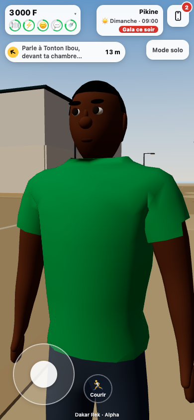 | 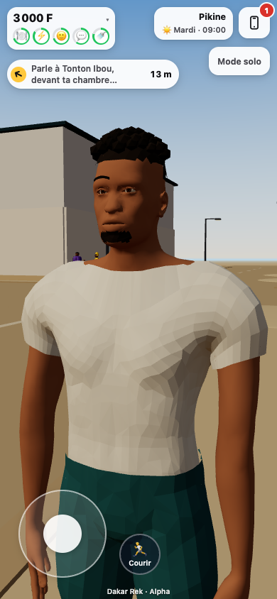 |
| Human proportions | 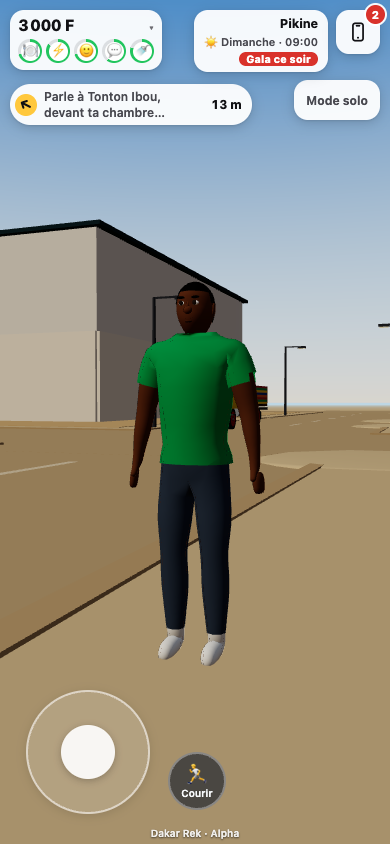 | 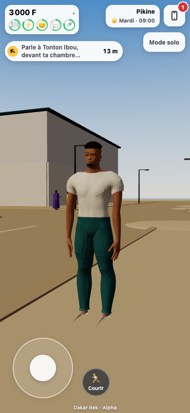 |
| Hands | 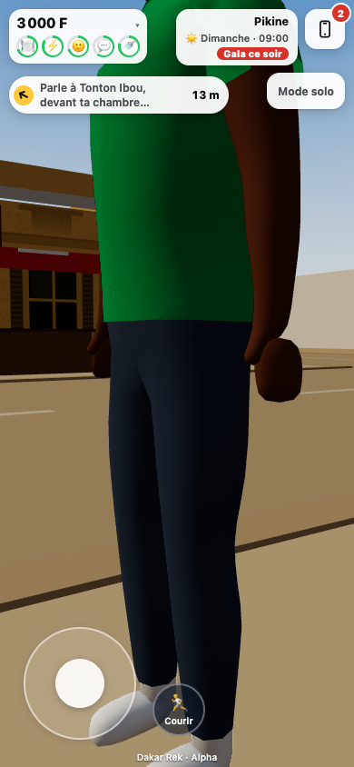 | 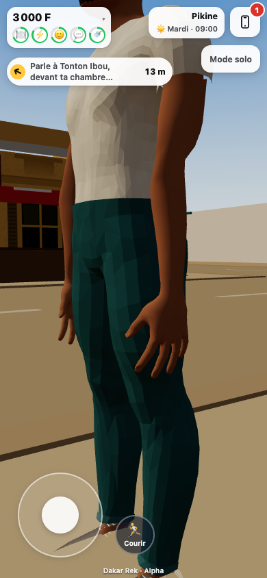 |
| Normal street camera | 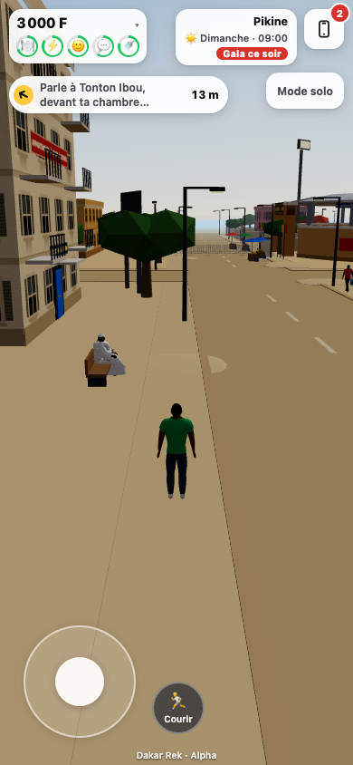 | 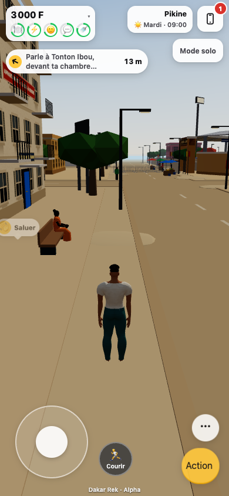 |

| Motion / seating | Candidate capture |
| --- | --- |
| Walk | 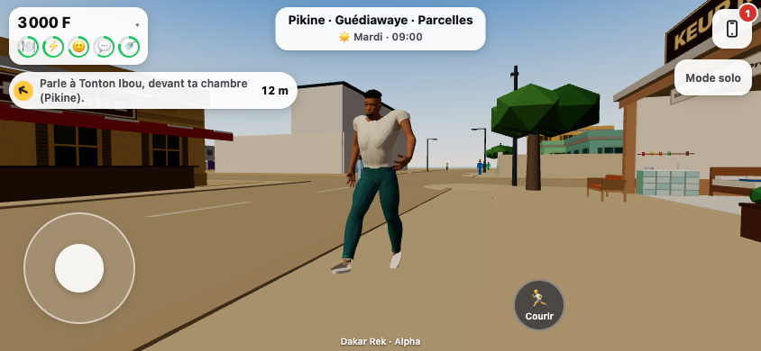 |
| Jog | 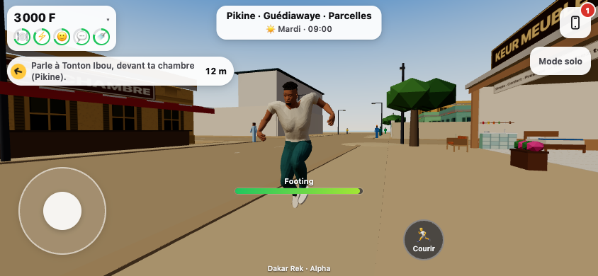 |
| Sprint | 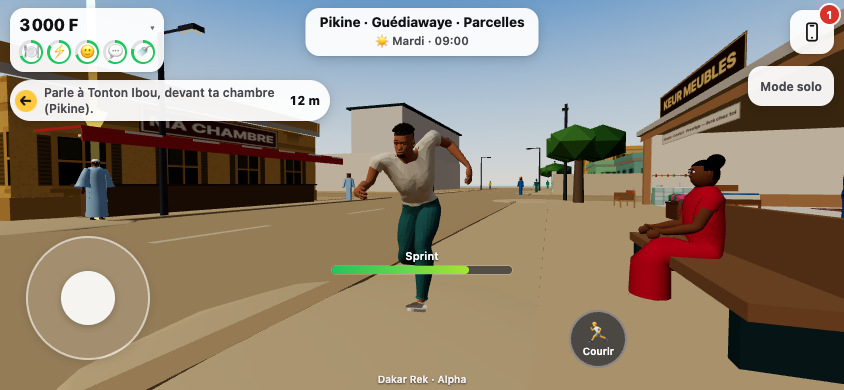 |
| Quarter-turn | 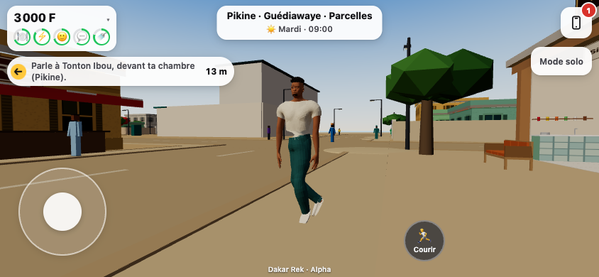 |
| Actual city bench | 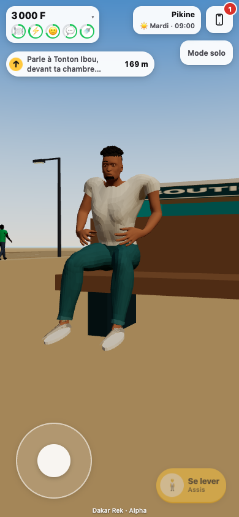 |

Matching landscape before/after, side profiles and additional motion captures are in
`screenshots/reference-character`. [Browser results](screenshots/reference-character/results.json).

## Asset and motion

The source is fresh licensed MakeHuman anatomy, a fitted CC0 garment, new authored hair/face details,
cuffs and sneakers. It does not import V4/V6 geometry or apply V4's face/gait corrections. Full licensing,
input hashes, reconstruction parameters, Blender source and rebuild steps are in
[the source register](../assets-src/reference-character/README.md).

| Mobile asset check | Result |
| --- | --- |
| Exported GLB | 1.95 MB, no bitmap textures |
| Geometry | 18,067 triangles; one skinned mesh/material |
| Rig | 52 bones, including three weighted joints per finger |
| Stature | 1.78 m anatomical source, human proportions |
| Requested motion | Idle, walk, jog, sprint, captured quarter-turn, sit; one-shot sit/stand transitions |

Quaternius motion and CMU captures are retargeted to this rig. The relaxed idle closes a three-second
loop; locomotion adapts stride to human legs, preserves the captured knee pole/foot orientation, and
retimes from measured sole speed. Actual stable cadence is about 135 / 166 / 204 steps per minute at
the existing 2 / 4.2 / 7 m/s speeds. Physics owns horizontal travel. The reference player's soles align
with the actual road/sidewalk/block heights instead of floating at the legacy body's origin.

Bench fitting uses butt contact at the existing 0.48 m seat offset, with this rig's pelvis at 0.62 m.
The preview profile retains nickname editing but offers no appearance swatches or character creator.

## Verification

- Full suite: **1,396 passed, 2 skipped**, including seven actual GLB/runtime checks for skin weights,
  individual finger joints, asset limits, moving clips, idle-loop closure, contact, bench fitting and cadence.
- Client build and server typecheck passed; the existing large JS chunk warning remains.
- Real game in Chrome mobile emulation, 390×844 and 844×390: one active 52-bone player, joystick
  movement and cancellation, walk/jog/sprint, turn, actual bench seating, fixed-look profile and clear
  central HUD; no page errors. Standing soles match 0.08 / 0.12 / 0.14 m road/sidewalk/block surfaces.
- Low gala check: **11/11 passed**, including proof that the reference player is active. Existing budgets
  remain 180 draw calls / 4 ms JS update / 0.8 ms crowd update. [Measurement](perf/reference-character-low.json).

```sh
npm test
npm run build
npm run typecheck:server
CHROMIUM=/path/to/chrome node scripts/check-reference-character.mjs http://127.0.0.1:4174/ docs/screenshots/reference-character
CHROMIUM=/path/to/chrome node scripts/check-reference-character.mjs http://127.0.0.1:4175/ docs/screenshots/reference-character/before --baseline
CHROMIUM=/path/to/chrome node scripts/check-perf-evening.mjs http://127.0.0.1:4174/ docs/perf/reference-character-low.json --presets=low --reference-character
```

This is an art-and-motion draft, not a migration of every legacy pose/outfit/combat scene. NPCs, floor/bed
poses and fighting appearances still need a separate port after the visual direction is accepted. Tests
use Chrome/SwiftShader emulation; physical-phone FPS and final likeness acceptance remain to verify.
No integration merge, release push, Cloudflare configuration change or production deployment was made.
