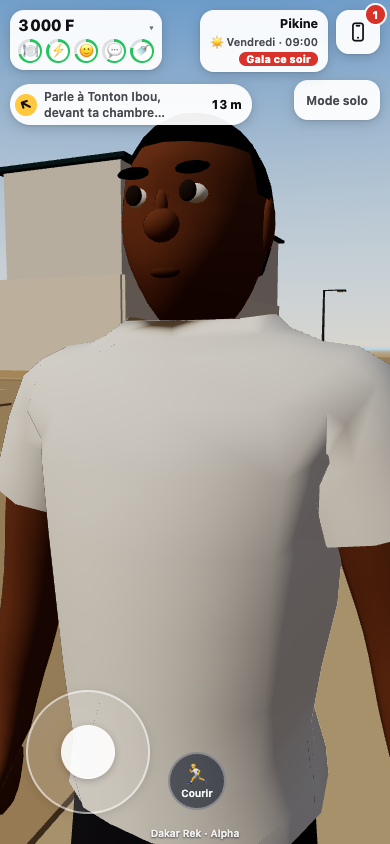
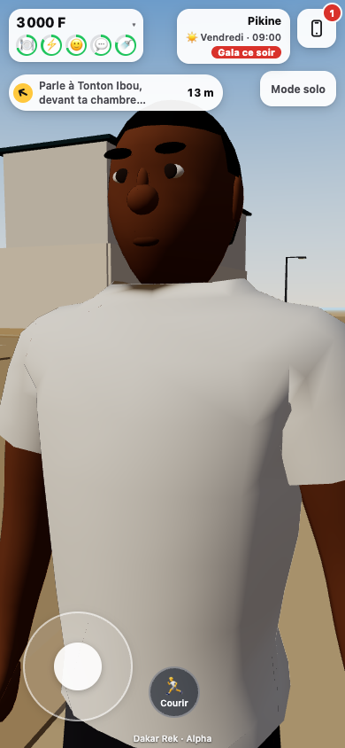
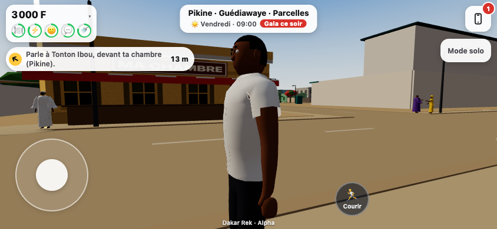

# V4 eye fit — mobile visual candidate

Fresh isolated branch from `integration/living-dakar@0cbf0d4`, checked again on 13 October 2026. V6 is not used.
The current integration's shorter neck, oval head and grounded gait remain the baseline. The separate mobile control
fix is [draft PR #25](https://github.com/zayd95/dakar-rek/pull/25), not included in this branch.

V4's exported iris meshes float entirely in front of the eye whites: a 2.28 mm gap, with their front 10.52 mm past the
white's front. At load time, the existing eyes are made slightly flatter and oval; the iris lenses sit in the whites
with only 0.2 mm of their front above the surface. Their normals follow the scale. A corrected export is left alone.
No meshes, triangles, draw calls, textures, materials or per-frame work are added. The V4 asset bytes, weights, clips,
head proportions and clothing are preserved. This is a small visual candidate, not owner-approved final art.

Matched 390×844 and 844×390 captures use the same outfit, camera and stepped pose: front, three-quarter, profile,
close-up and female/headwrap. All were inspected. Page errors and central HUD overlaps: zero.

| Before | After |
| --- | --- |
|  |  |
|  |  |

[All captures and bounds](screenshots/eyes/). Tests load the real GLB, reproduce the gap, check the fitted overlap before
and after the existing head warp, preserve topology/weights/non-eye parts, verify normalized normals and idempotence.
14 focused tests and the full unit suite (1,392 passed, 2 skipped) pass, as do build and client/server types.
Low gala budget: 10/10 pass. Arrivals/bout/outflow: 113/107/139 calls ≤180; JS update 0.48/0.36/0.46 ms ≤4;
crowd update 0.063/0.013/0.037 ms ≤0.8. [Raw measurements](screenshots/eyes/perf-low.json).

Chrome emulation/SwiftShader, not a physical-phone FPS measurement. Draft toward integration only; no release change,
Cloudflare configuration change, merge or production deployment. The takeover audit and release/integration divergence
are recorded in [PR #25's report](https://github.com/zayd95/dakar-rek/blob/codex/mobile-touch-controls/docs/MOBILE_TAKEOVER_2026-10-13.md).
