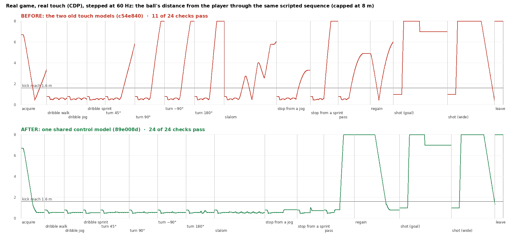
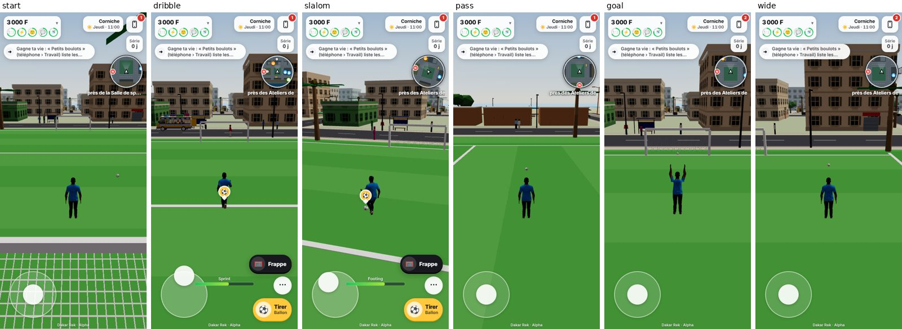

# Football · ball control: root cause, repair and proof

**Status: engineering evidence only. No iPhone has run this.** The real-touch runs below use Chromium with Chrome's own touch events (CDP), not a phone. See [What is not proven](#what-is-not-proven).

- **Branch:** `fix/football-ball-control-20261026`, stacked on the M3 branch (`feature/ld-m3-corniche-20261026` @ `c54e840`, zayd95/dakar-rek#73). It touches no M1 or M2 file.
- **Code:** `89e008d`. The commit after it adds only this document, the check script and `proof/football/`.
- **Scope:** a bounded repair of the existing football. No second engine, no change to the NPC match, no new district work, no change to the milestone order.

## What was wrong

The M3 evidence showed the match screens (offer, dialogue, result). It did not show anyone dribbling, and the dribbling was in fact bad. The ball was lost on almost any change of direction.

The problem was measured before it was changed, on both of the places a player meets the ball. The player's own movement was the game's own code (`Stride.analog`, `turnStep`, the ×0.8 stop), at 60 fps:
- the **kickabout** (`kickabout.ts` `dribble`: the pitch's ball when no NPC match is on);
- the **player in the NPC match** (`footballSim.ts` `humanTick`, added in M3).

| Scenario | Before |
|---|---|
| Straight at a walk or a jog | held (kickabout), but only 0.8 touches a second |
| Turn 45° | ball lost for good: 3.5 m away 1–2 s later, 12.6 m 4–6 s later (window means) |
| Turn 90° / 180° | lost: 17 m / 21 m away 4–6 s later |
| Slalom (±0.8 rad each second, after 2 s straight) | 15 % of the frames within a stride |
| Stop from a jog | ball rolls 4–6 m away |
| Stop from a sprint | ball rolls 23 m away |

**Causes**, found in the code and confirmed by frame-by-frame traces:
1. **Touches only along the velocity.** A touch fired only when the ball was *ahead of the velocity*, and it was kicked *along the velocity*. After any turn the ball was beside or behind the body and kept rolling the old way. `ROLL` is 1.2 m/s², so it rolled on for 15 m or more. Nothing could touch it again.
2. **No possession state.** Nothing took the pace off a ball that arrived, or one that ran on past the feet when the body stopped. The body stops in a few frames; the ball does not.
3. **Two touch models.** `kickabout.dribble` and `footballSim.humanTick` had different numbers. The match human was also blocked from touching again for 0.2 s after every touch by the NPCs' kick-animation window (`free(p)`), so it touched once every 1.5 s.

## The repair

One pure function, `planTouch` in `footballSim.ts`, is now the control model. Both callers use it. The ball is never attached: it is played in discrete touches and rolls by itself (`stepBall`) between them.

- **Dribbling.** A touch plays the ball to a point `CONTROL.lead` (0.55 m) ahead of where the body will be at the next touch, along its *facing*. The speed is the one that brings it there rolling under `ROLL`. Faster bodies touch more often, 0.22–0.45 s apart.
- **A touch is due at once** (after 0.05 s, not on the cadence) when:
  - the body has turned more than 0.5 rad since the last touch,
  - the ball has drifted 0.55 m or more from the foot,
  - or the ball is level with or behind the body.

  A ball beside or behind a moving body is played forward along its side and never in through the body.
- **Standing.** A ball that arrives or runs on is trapped: each trap keeps 25 % of its pace, and a ball far from the foot is drawn in to rest 0.6 m ahead. A ball at rest is left alone. A standing player reaches 1.4 m from the foot for a trap, against 1.05 m for a dribbling touch.
- **Velocity.** The velocity the model reads is smoothed quickly (`VEL_SMOOTH`, 30/s), so a stop is seen as a stop within a few frames.

Files changed (3 source files, 116 insertions, 44 deletions):
- `footballSim.ts`: `planTouch`, `CONTROL`, `VEL_SMOOTH`; `humanTick` calls it.
- `kickabout.ts`: `dribble` calls it. Only a played touch restarts the cadence; the body's push-out safety net no longer does.
- `football.ts`: passes the body's facing and `VEL_SMOOTH`.

Dead ends found while tuning, kept out of the code: a cut-in of a ball beside the body went through the body (the push-out cancelled it every frame, so the ball sat pinned at the side with a touch every frame); a longer centre-based reach made a ball at rest follow a player who walked away. Both were caught by the tests and removed.

## Tests actually run

- `tests/ballControl.test.ts` (38 tests, new). The same expectations run on both paths, driven by the game's own player movement at 60 fps (`tests/helpers/footballBody.ts`, `footballRig.ts`):
  - acquire a loose ball;
  - dribble at a walk, a jog and a sprint;
  - the ball is never attached (touches at a human cadence, the distance varies, the ball has its own pace);
  - turns of ±45°, ±90° and 180°;
  - a slalom;
  - stops from a jog and from a sprint;
  - a ball arriving at a standing player;
  - **the sequence** acquire → dribble → turn → pass (the ball leaves and travels by itself) → regain → shoot (a real goal, counted once) → shoot wide (no goal, play goes on) → leave.
- **24 of those 38 fail on the previous implementation** (run against `c54e840` with a shim): every turn, the slalom, the stops and both full sequences. So they detect the defect.
- At **30 fps** all 38 pass. At **20 fps** all but the 180° flick pass (see limits).
- The full suite: **185 files, 2273 passed, 2 skipped**. `tsc` is clean.
- `scripts/check-ball-control.mjs`, the **real game with real touch** (below).
- `scripts/check-football.mjs` (the NPC match, `QUALITY=low`): **19 / 19**, unchanged. The NPC match does not use the control model.
- `scripts/check-match-journey.mjs` (the M3 golden path, real-time, real touch, against the NPC match): **25 / 25** ([log](proof/football/match-journey.log)). It is also the only run of the match path in the real game against opponents, with the same crude scripted thumb as before:

  | | M3 run 9 (before) | This branch |
  |---|---|---|
  | Match 1 | lost 1–3: 0 goals, 3 passes, 1 shot | **won 3–1: 3 goals, 5 passes, 5 shots** |
  | Match 2 | lost 0–3: 0 goals, 1–2 passes | **won 3–2: 2 goals, 5 passes, 2 shots** |

  This is one run each, not a statistic. It is indicative that the player can now keep the ball and score in the real match. It does not prove the feel.

## The real game, with real touch

`scripts/check-ball-control.mjs` plays the whole sequence in the actual game on the Corniche's pitch (390 × 844, touch emulation, SwiftShader):
- the fingers go through Chrome's input pipeline: the joystick, the action button (« Passer ») and the held « Frappe »;
- the game loop is paused and stepped one 1/60 s frame at a time, with a virtual clock, so physics runs at a phone's 60 fps whatever the headless renderer's speed;
- the thumb re-aims every 6 frames (0.1 s), as a thumb does;
- the ball and the body are read from the game's own state every frame.

Same script, same game, the old code against the new:

| Check | Before (`c54e840`) | After (`89e008d`) |
|---|---|---|
| Checks passed | **11 / 24** | **24 / 24** |
| Dribble at a walk / jog / sprint: touches a second | 0.8 / 0.8 / 1.8 | 2.5 / 2.9 / 4.1 |
| Turn 45° / 90° / −90° / 180°: farthest the ball got | 5.8 / 9.9 / 9.9 / 13.6 m | 0.61 / 0.62 / 0.62 / 0.74 m |
| Slalom: share of frames within a stride | 23 % | 100 % |
| Stop from a jog: ball at rest, distance | 3.3 m | 0.83 m |
| Stop from a sprint: ball distance | 13.0 m, still rolling | 0.73 m, at rest |
| Pass: leaves at pace, no jump, the body does not re-touch it | not reached (see below) | 10.9 m/s, jump 0.001 m, 0 touches |
| Regain: ball at the foot at rest | 6.0 m | 0.79 m |
| Shot: crosses the goal line, one goal, not counted again | pass | pass |
| Wide shot: no goal, ball stays in, taken again | pass | pass |
| Leaving: the pitch lets go, the stick walks as usual; no page errors | pass | pass |

In the old run the two pass checks fail only because the preceding stop left the ball 3–13 m away, so « Passer » was not on the action button. The shot, the goal counted once, the wide shot and leaving were already correct before. That is the work *around* the dribble. The ball control itself was broken.

Logs: [`proof/football/after.log`](proof/football/after.log) and [`before.log`](proof/football/before.log), with the measured values in `after-summary.json` and `before-summary.json`.

Re-run with `node scripts/check-ball-control.mjs <baseUrl> <outDir>` (a running build, e.g. `npx vite --port 4640`).

## What is not proven

- **No iPhone.** The runs above are Chromium with touch emulation. They prove the logic through the real input pipeline at 60 Hz. They do not prove how it feels on a phone, at a phone's real frame rate, under heat, or with a thumb. The owner's iPhone playtest of the pitch (Gate B) is still the check that decides this.
- **No verified preview.** The Cloudflare Workers Builds check fails on new branches in this project, an instant failure with no log, as on #67 and #73. No preview of this build exists to open.
- **20 fps.** At 20 fps a full 180° flick still loses the ball (the body pivots in two frames). At 30 fps and above every test passes. The game caps a frame at 0.1 s.
- **The player's body has no kicking animation.** The ball moves by touches, but no leg swings. This is not changed here.
- **The NPC match.** In the real game the match path is checked by the shared model's tests and by the M3 journey regression, not by a stepped real-touch run. Opponents there tackle and press, and the player taking the ball *back from an NPC* is not measured. The NPC match itself is unchanged.
- **The thresholds are mine** (« within a stride », cadence, rest distance), chosen from the measured before and after. They show the ball is controlled, not that it is fun.
- **« Passer » without a receiver is still a straight punt at about 11 m/s.** That is the existing behaviour and is unchanged.
