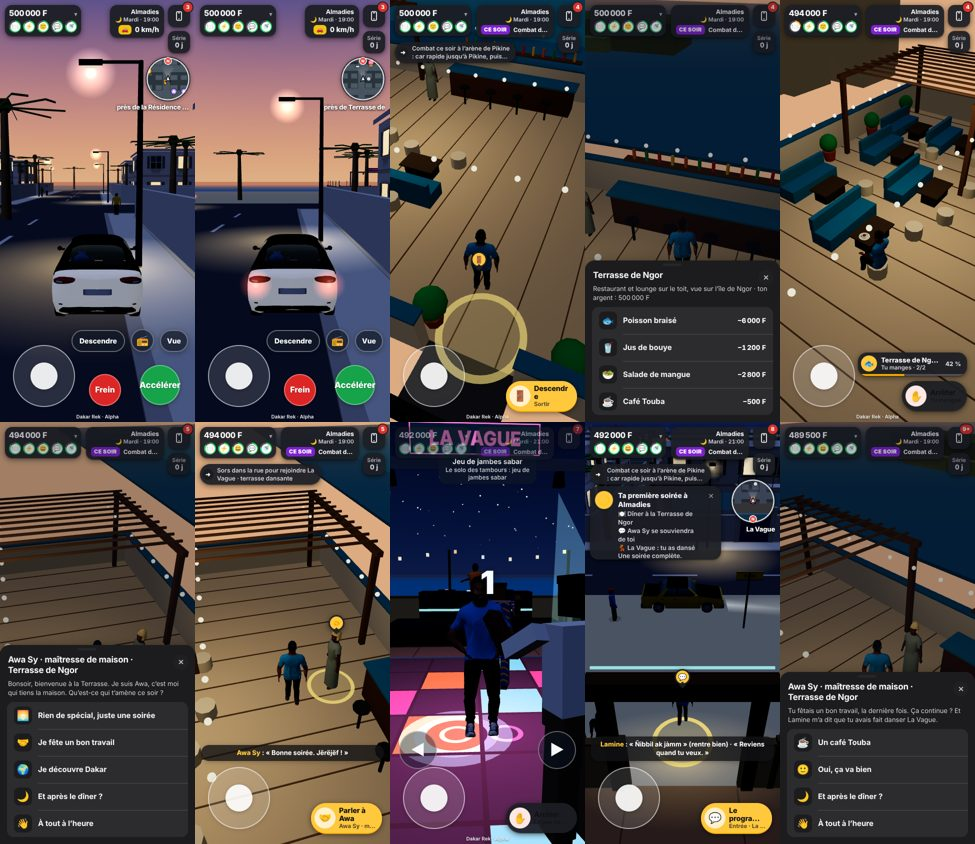

# M4 · Almadies / Ngor — evidence

**Gate A (engineering) only. No iPhone has run this.** Everything below is Chromium with touch emulation (Chrome's own touch events), SwiftShader, quality `low`, 390 × 844. See [What is not proven](#what-is-not-proven).

- **Branch:** `feature/ld-m4-almadies-20261026`, stacked on the football repair (`fix/football-ball-control-20261026` @ `7c42429`, zayd95/dakar-rek#74), itself on M3 (#73), M2 (#70) and M1 (#67).
- **Design:** [`M4-ALMADIES.md`](M4-ALMADIES.md). **Contract:** [`CONTRACT.md`](CONTRACT.md) v8, row 14 (proposed, LD2.0 to confirm).

## The golden path, with real touch

`scripts/check-almadies-journey.mjs`: one session, real fingers through Chrome's input pipeline (joystick, the pedal stick, the action button, taps on the sheet rows), video recorded. Log: [`proof/m4/journey.log`](proof/m4/journey.log), a small video: [`proof/m4/journey.mp4`](proof/m4/journey.mp4) (270 px wide, recompressed), frames: 

| Step | What the run does, and what it checks |
|---|---|
| Travel and park | The Teranga, driven with the pedal stick along the lane nearest the terrace's door and parked: on the road, within 25 m of the door; stepping out leaves it saved as parked in Almadies. |
| Go up | On foot from the car (round its tail) to the door, « Entrer », up the stairs. |
| Meal | « Commander » at the bar, « Poisson braisé »: **6 000 F charged once, at the start**; not fed while it is prepared; the guest **walks to a table and sits**, the **plate is on the table** within reach of the seat; the last bite raises `faim` by 60 points; the wallet is untouched after the start; the meal counts once; « Se lever ». |
| Awa Sy | « Parler à Awa »: she introduces herself (short; three answers); « Je fête un bon travail » gets an answer that follows it and sends the guest to La Vague (the walking marker points to it). `social` rises by 8 once; the choice is remembered; she is a known face. **Asking again the same evening** gives no social, no second visit. |
| La Vague | By the streets to the gate (21:30, a labelled hour shortcut). The fee is shown before anything is paid; **2 000 F paid once**; one dance (the beat game finished with the existing debug shortcut, as `check-venues.mjs` does); La Vague's own counter moves and the evening knows it. |
| The end | Leaving the club: **one card**, « Ta première soirée à Almadies » with dinner, Awa, the dance and « une soirée complète »; counted once (`al_evenings` 1, `al_last_mask` 7). |
| Home | The taxi at La Vague's rank: the fare **paid once**, one ledger line, arrival in the Corniche; the card is not shown a second time. Back in Almadies the car is **exactly where it was parked** (one car, not a copy). |
| Another evening | The next city day (a labelled debug shortcut): on the stairs Awa remembers what the guest said and did; at the table her words are **not** the first evening's; the house offers **one coffee, free** (nothing charged); a second word the same evening has no coffee. |
| Reload | Save and reload: the evenings, the choice, the meeting and the gift are all there, nothing counted again; only `al_` counters were written. |

**Result:** the run passes all its checks (see the log's last line), with no page errors.

## Regressions
- **Unit tests:** `tsc` clean; the full suite passes (186 files; 2280 passed, 2 skipped). New: `tests/almadies.test.ts` (7): the evening is the club's night; a stage counts only when the activity's counter moves; the first word, recognition and the once-an-evening gift; the card once; only `al_` counters.
- **`scripts/check-rooftop.mjs`** (Plateau, Corniche, Almadies): rewritten for the real order, 43 checks pass on the three rooftops.
- La Vague, the taxi, the vehicles, the NPC match and the football files are unchanged.

## Performance

`scripts/m4-views.mjs`, the same script on the previous tip (`7c42429`) and on this branch (draw calls / triangles of one frame; budget 300 calls):

| View | Quality | Before | After |
|---|---|---|---|
| Street at the terrace's door | low | 64 / 71 988 | 63 / 71 800 |
| Street at the terrace's door | medium | 72 / 95 810 | 72 / 95 574 |
| Terrace, at the bar | low | 11 / 21 870 | 21 / 27 250 |
| Terrace, at the bar | medium | 11 / 28 182 | 21 / 33 562 |
| Terrace, at the stairs | low | 10 / 21 670 | 16 / 26 778 |
| Terrace, at the stairs | medium | 10 / 27 982 | 16 / 33 090 |

Awa (one body) costs about 10 draw calls and 5 000 triangles, and only while the terrace is on screen. The street is unchanged. These are headless SwiftShader counts, not frame times on a phone.

## What the run found and fixed
- The tables stood across the way in: from the stairs the stick got stuck against a sofa. The east side is clear now (six tables instead of seven).
- At the bar the stool's « S'asseoir » beat « Commander » (the bar's focus bias was 1.6 against a stool 0.5 m away). The bias is 0.1 now.

## What is not proven
- **No iPhone.** Chromium with touch emulation does not show how the evening feels on a phone, at 60 fps, with a thumb. The owner's iPhone playtest (Gate B) decides this.
- **No verified preview.** Cloudflare Workers Builds fails instantly on new branches in this project (as on #67, #73 and #74), so no preview of this build exists to open.
- **Labelled shortcuts in the run:** the hour (21:30 for La Vague, then 19:00 on the next city day), the next day, putting the car at the start of its lane, the beat game's finish (`gestureFinish`), and the teleport back into Almadies after the taxi. The drive, the parking, every walk, every tap, the order, the talk, the club's door and the taxi were done with fingers.
- **The beat game was not played on the beat.** The dance counted comes from the existing finish shortcut.
- **The taxi leaves for another district.** « Home » is proven with the taxi (and the car staying put), not with the player driving the Teranga home.
- **No waiter walks the food to the table at the rooftop**; the plate appears when the guest sits. No valet or parking-attendant system. The previous recording parks at the road edge; the marked visitor bay in the updated forecourt still needs a new run to prove it.
- **Pre-fix limitation:** the 40/40 video below predates the dedicated hospitality-strip change. The new door is on the authored Terrasse de Ngor frontage; rerun the journey and inspect the updated street view before treating the exterior as accepted.
- **One recurring character.** Awa remembers one choice and the stages of the last evening; there is no longer story.
- **The `walkTo` marker** is a marker on the neighbourhood's directory entry for La Vague, not a route.
- **Multiplayer:** the presence whitelist does not know the rooftop's space (an existing limit); other players do not see the guest on the terrace.
