# The Almadies district kit

**The owner (27 Oct):** « I love the villa .. now make adapt this style to almadies hub change all the old facades, create distinctive shapes like this with doors balcony etc .. we should have houses, villas, hotels and apartment complexes that what makes almadies different. » and, on the first pictures: « This is cool, I don't want them in isolated areas they part of what makes the city ».

Fourteen designs in the flagship villa's style (ivory render, travertine, oak, bronze, glass; cantilevered slabs, glass guards, deep balconies, a real front door, a roof terrace), in four kinds, on 30 sites that cover 41 lots of the Almadies (`src/world/almadies/plan.ts`). Every design is a named builder, drawn on the villa's drawing context (`src/world/villaCompound.ts` `makeDraw`) into the hub's merged batches: no draw call per building (a sign board is one, at most one per hotel or residence).

**Open to the street.** The district is part of the city, not a set of compounds. The boundary is a railing on a low plinth along the street and every edge that runs by a road, a wall only between neighbours; every design has a walk-in way from the pavement to its door, lobby or passage; the hotels and residences have cafés, shops and lobbies at street level.

**Files:**
- this catalogue;
- the pictures: `docs/kits/almadies-district/<id>-front.png`, `-street.png` (eye level, from the pavement), `-night.png` (21 h);
- each design as a 3D file: `docs/kits/almadies-district/glb/<id>.glb` (colours, no textures);
- the numbers: `docs/kits/almadies-district/cost.json`.

`scripts/shots-district-designs.mjs docs/kits/almadies-district --views front,street --glb docs/kits/almadies-district/glb` makes the pictures, the numbers and the GLB files in a real browser, through the district viewer (`tools/district-viewer/`, `src/world/almadies/viewer.ts`: `window.district.show({ kind, variant, facing, mirror, palette, storeys, night, lite, roads })`).

## How a design is built
- **A site** (`contract.ts` `Site`): kind, variant, block and lots, rectangle, facing (the street side), mirror, storeys, palette, name and house number, the car gate's side. `siteDraw(kit, site)` is the plan's frame (metres from the site's origin, +z toward the street, x along it, y up, the ground at 0.1) and the batches.
- **A design** is `Variant { id, name, size, build }`; `build(d)` draws and returns what it keeps clear and its group. The registries are `houses.ts`, `villas.ts`, `hotels.ts`, `residences.ts`; `district.ts` `buildDistrict(kit)` draws the plan.
- **The shared pieces** (`parts.ts`): `volume`, `slabEdge`, `parapet`, `glazing` (about three panes in four lit at night), `louvres`, `balcony`, `canopy`, `pergola`, `door`, `nameBoard`, `planter`, `roofPlant`, `palm`, `paving`, `solidBox`, and `perimeter`.
- **`perimeter(d, { gate, entries, front, h })`**: the open boundary. A bronze railing of flat bars (1.3 m) on a 45 cm stone plinth, stone piers, short trimmed hedges, along the street edge and every edge that runs by a road (`roadEdges(d)`: the site reaches the block's edge); 2.4 m walls between neighbours; a bar gate, shut and solid, where the site says; `entries: [{ x, w }]` cuts a walk-in opening (open ground between two lantern piers, nothing solid across it). About 250 triangles for a 22 m lot's street edge and one road side, 550 for two lots, 900 for a block.
- **Palettes** (`contract.ts` `PALETTES`): ivory, sand, greige, oak, terracotta, azur.
- **Budgets** (`TRI_CAP`, medium, gross; the low preset draws about 65–80 % of it): house 1.8 k, villa 2.85 k, hotel 5.6 k (2 lots) / 9.2 k (4), residence 3.9 k (1 lot) / 5.2 k (2) / 8.2 k (4).
- **Never** `Math.random` (every client draws the same street); no mesh of its own beyond the batches and one sign.

## Houses (1 lot, 2–3 storeys)
| | Design | Medium / low triangles |
|---|---|---|
| 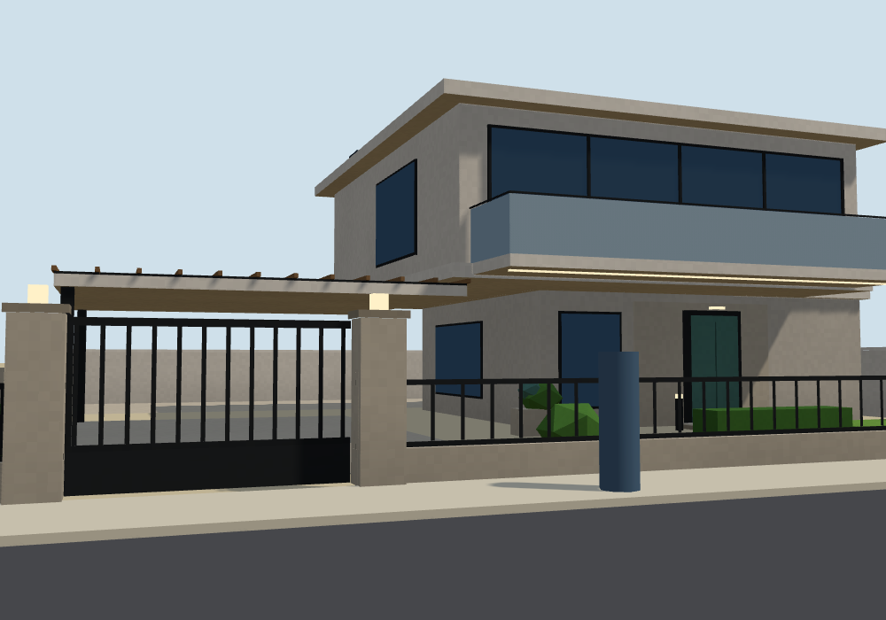 | **house-m1 · Maison empilée**: offset stacked boxes, a big glass-guarded balcony over the street, an oak-slatted carport slab. | 1 504 / 1 180 |
| 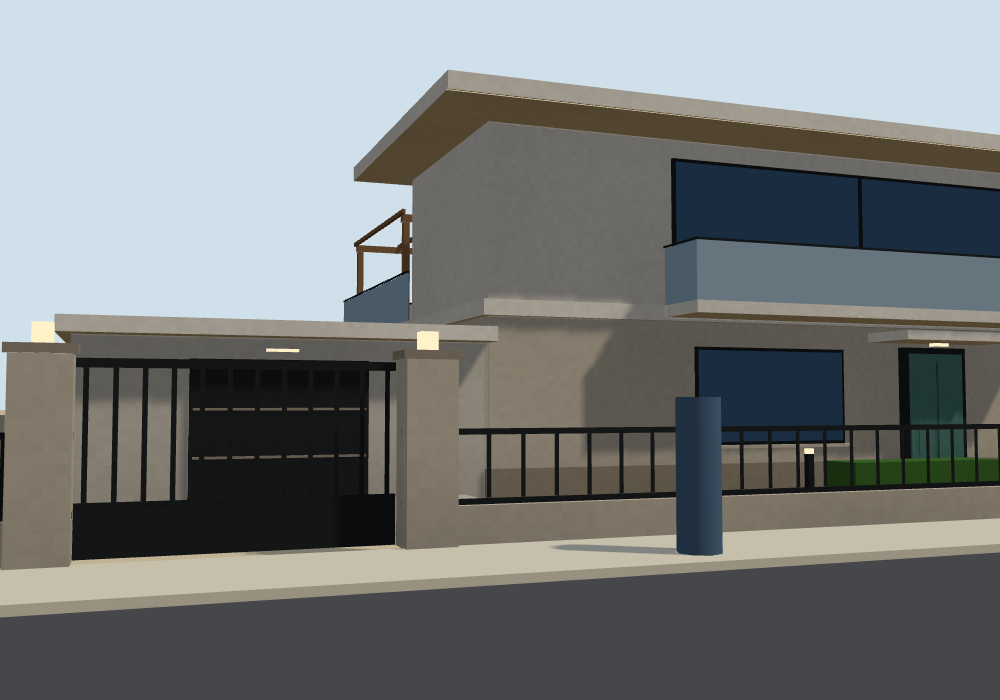 | **house-m2 · Maison en L**: two wings under one deep flat roof, a loggia in the L's corner with a terrace and a timber pergola, a stone plinth, a garage with a green roof. | 1 570 / 1 304 |
| 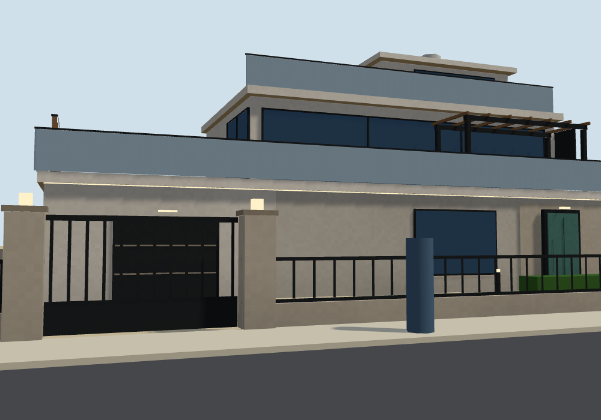 | **house-m3 · Maison à gradins**: three masses stepping back, terraces with glass guards, an oak screen, a corner window, a roof room. | 1 578 / 1 278 |

## Villas (1 lot, 2–3 storeys, a pool)
| | Design | Medium / low triangles |
|---|---|---|
| 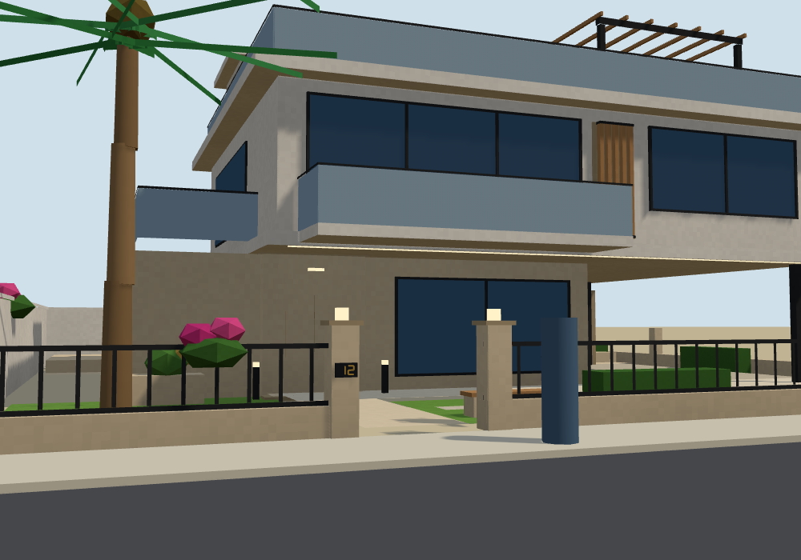 | **villa-c1 · Villa Porte-à-faux**: a long white volume cantilevered 5.6 m over the carport, a deep balcony, an oak claustra on the end. | 2 558 / 2 092 |
| 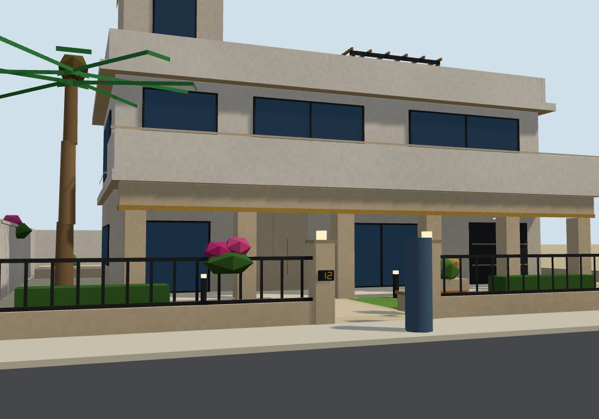 | **villa-c2 · Villa des Arcades**: a portico of square piers and a deep lintel, a sand ground floor, accent bands, a small stepped tower, a roof terrace. | 2 412 / 2 000 |
| 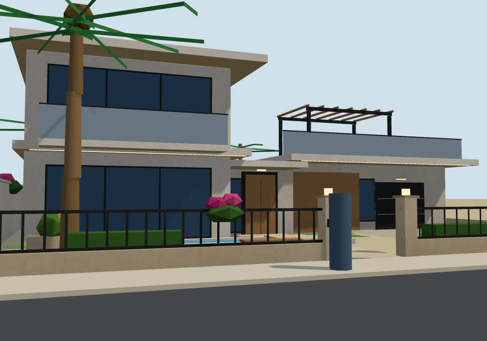 | **villa-c3 · Villa des Pavillons**: a tall living pavilion and a low suite/garage pavilion under deep thin roofs, a glazed link with the door, a long water mirror in front, a long pool and a pergola behind. | 2 482 / 2 016 |
| 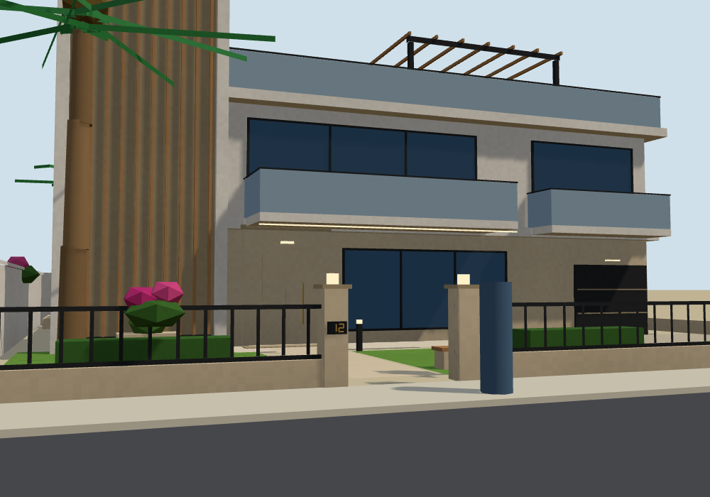 | **villa-c4 · Villa de la Tour**: a stair tower in vertical oak slats rising a storey above the house, stacked and staggered balconies, a rooftop lounge. | 2 560 / 2 026 |

All seven: a walk-in opening in the railing in line with the front door and a short stone path to the step (a test walks a body from the pavement to the door on 2 and 3 storeys, both facings, every gate side, mirrored or not), the car gate shut and solid, the house number on the pier, a bench and bougainvillea by the entry on the villas.

## Hotels (fictional names on lit signs)
| | Design | Medium / low triangles |
|---|---|---|
| 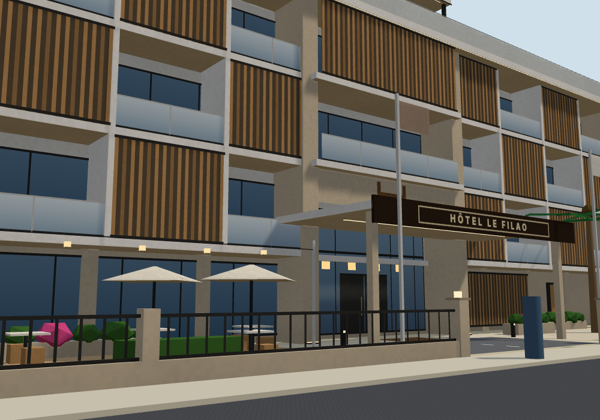 | **hotel-boutique · Hôtel boutique, façade de balcons** (2 lots; HÔTEL LE FILAO): a balcony on every room, a lobby under a porte-cochère canopy, a café terrace beside the opening, a rooftop pool and lounge. | 5 020 / 3 558 |
| 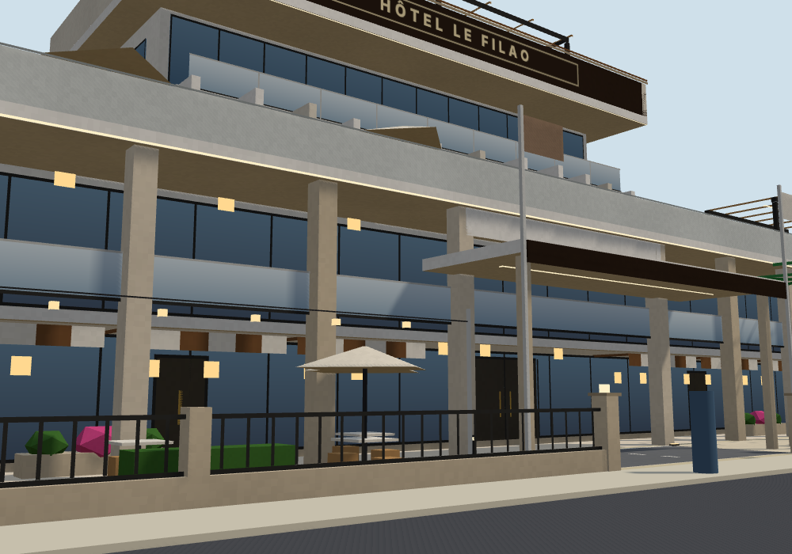 | **hotel-tower · Hôtel tour sur son podium** (2 lots; HÔTEL OCÉANE, 8 storeys): shopfront bays with awnings and two shop doors at the podium, an open lobby, a restaurant floor, the tower and its crown. | 4 638 / 3 414 |
| 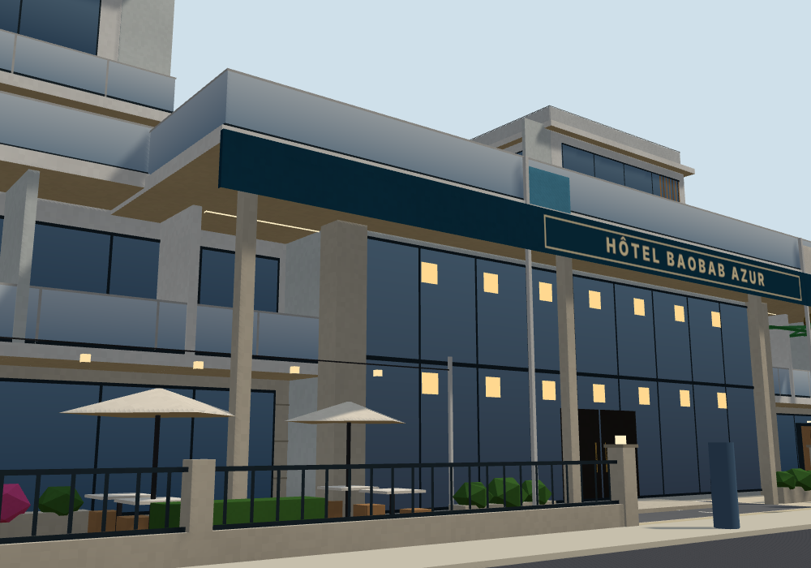 | **hotel-resort · Resort autour de la cour de la piscine** (the whole block; HÔTEL BAOBAB AZUR, 5 storeys): a long sea-front block, a pool court, an 8 m drop-off through the railing, a café terrace, garden suites on the road sides. | 8 648 / 6 564 |

## Residences (apartment complexes)
| | Design | Medium / low triangles |
|---|---|---|
| 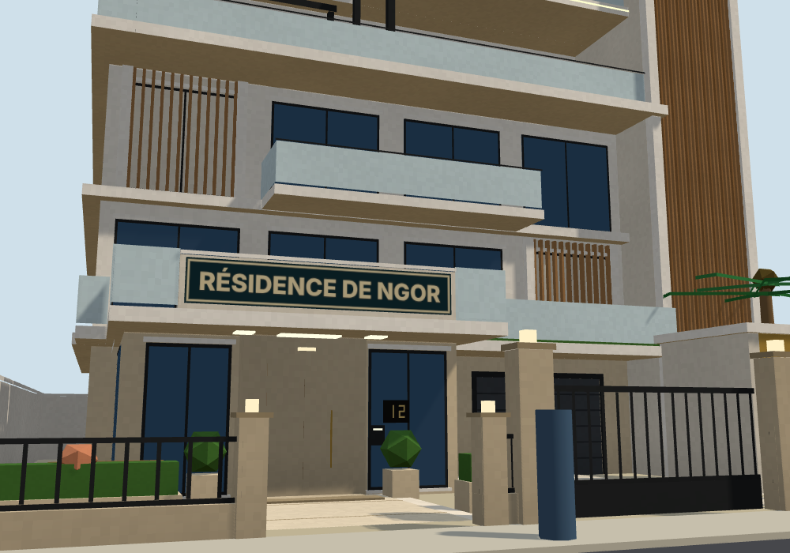 | **residence-ngor · Résidence de Ngor** (1 lot, for sale in the game): the gate at the lot's centre, a 3.2 m opening to a glazed lobby under the terrace canopy with intercom and name board, a café with an awning, forecourt paving and topiary. The estate's door, entry and sale board on the pavement stay free. | 3 112 / 2 138 |
| 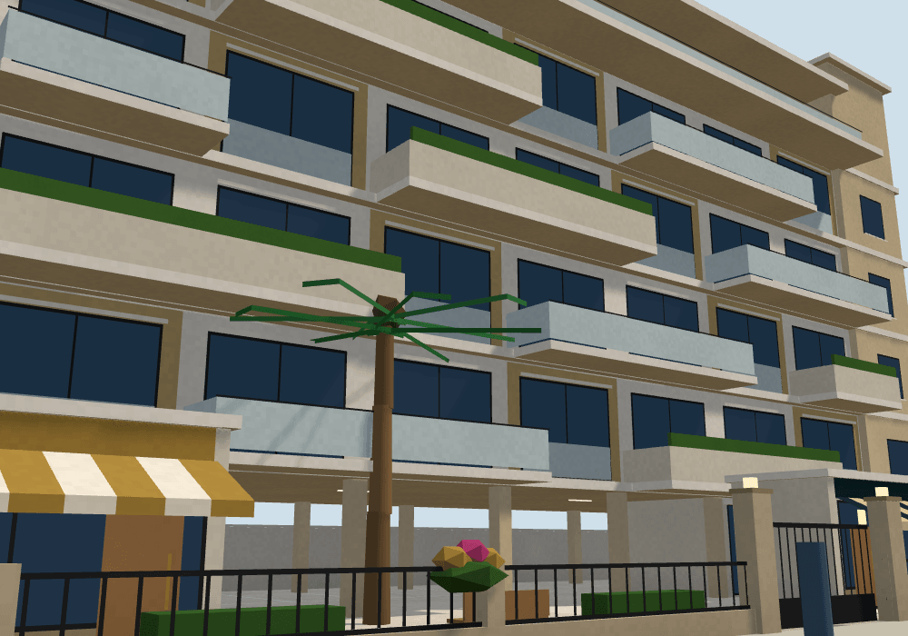 | **residence-stack · Balcons décalés sur pilotis** (2 lots; RÉSIDENCE LES ALIZÉS): staggered balconies on pilotis, a stone gateway over the lobby opening carrying the name sign, a café and a shop with awnings, the gated parking court. | 4 772 / 3 118 |
| 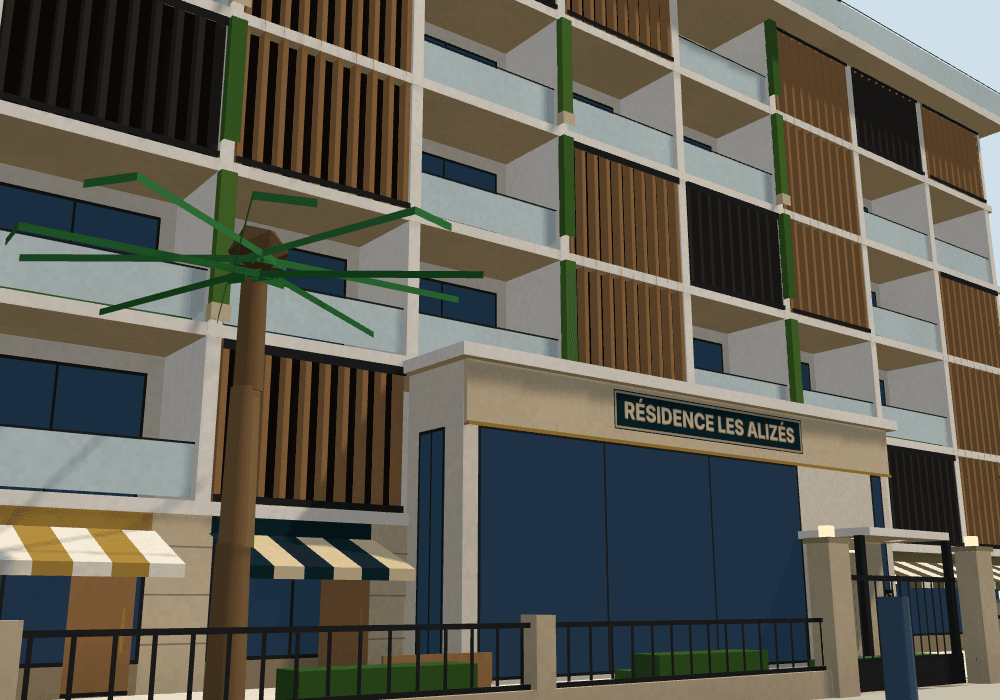 | **residence-screen · Brise-soleil sur loggias** (2 lots; KËR SALAM, LES CORMORANS mirrored): brise-soleil blades over loggias, a glass lobby that wraps its corner, a café, a shop and a boutique along the plinth. | 4 686 / 3 344 |
| 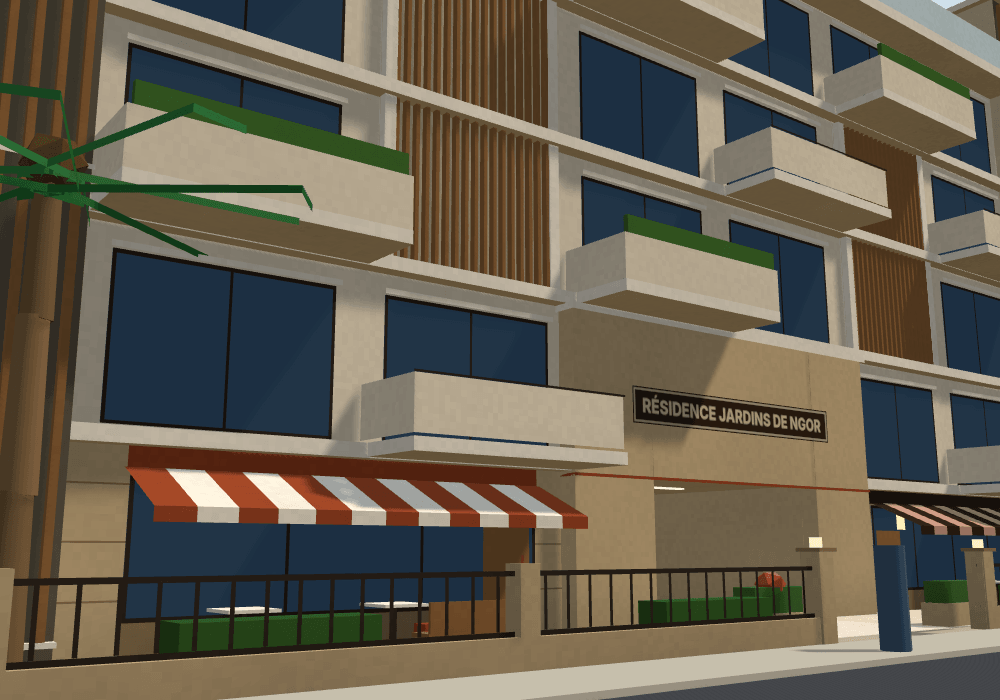 | **residence-courtyard · Cour-jardin à portail** (the whole block; RÉSIDENCE JARDINS DE NGOR): four wings round a courtyard and its pool, a 5.2 m porte-cochère you can walk through from the pavement, the car gate at the side, a café and a shop either side of the passage. | 7 776 / 5 518 |

## Night
Each design's `-night.png` (21 h) shows the lit panes (about three in four; the rest stay dark by the district's own rule), the uplights, pendant lamps and string lights of the terraces, the lantern piers and the lit sign. The panes' glow is the district's own shared material (`src/world/almadies/night.ts`, driven by the hub's night like the villa's facade).
