# The Almadies villa kit

**The owner (27 Oct):** « Save all the assets for the villa we will replicate this design to other houses to give almadies the luxurious feel. »

Every piece of the flagship villa (`villa_almadies`, the Almadies block (1,1) lot 3) is a named, reusable builder with parameters, so another Almadies lot can be built from it. The kit is `src/kits/almadiesVilla.ts`: a thin layer that names the pieces and parameterises the builders the flagship is drawn with. It does not draw anything its own way.
- **The street compound's pieces** are `src/world/villaCompound.ts`'s.
- **The house** is lane V-S's façade and plan: `src/housing/villaFacade.ts`, `villaPlan.ts`, `villaFinish.ts`.
- **The helicopter** is `src/world/helicopter.ts` `buildHelicopter()`, lane R2-H's (merged here from `integration/ld2-d-20261026` at `ab398f7`).
- **The furniture** is the game's own models: `src/economy/furnitureModels.ts`, and the kit in `src/world/furnitureKit.ts`.

With the flagship's spec the kit draws the flagship exactly. `tests/villaKit.test.ts` checks every primitive, mesh, collider, canopy, ground kept open and pool of light against `tests/fixtures/villaCompoundOwn.json`, pinned before the kit, at both qualities. The rest of the Almadies is unchanged too: `tests/villaCompound.test.ts`, `tests/helpers/lotDigest.ts`.

The kit places nothing in the city: building other lots from it is the next step, once the owner has seen it.

**Files:**
- this catalogue;
- the pictures: `docs/kits/almadies-villa/*.png`;
- each piece as a 3D file: `docs/kits/almadies-villa/glb/*.glb`;
- the numbers: `docs/kits/almadies-villa/kit.json`.

`scripts/export-villa-kit.mjs` makes the pictures, the numbers and the GLB files in a real browser, through the kit's viewer page (`tools/kit-viewer/`, `src/kits/viewer.ts`).

## The whole villa

| By day | At 21 h | From the garden |
|---|---|---|
| 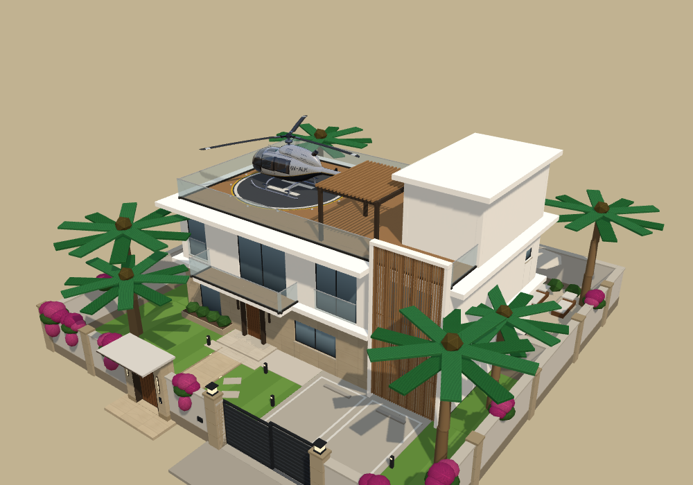 | 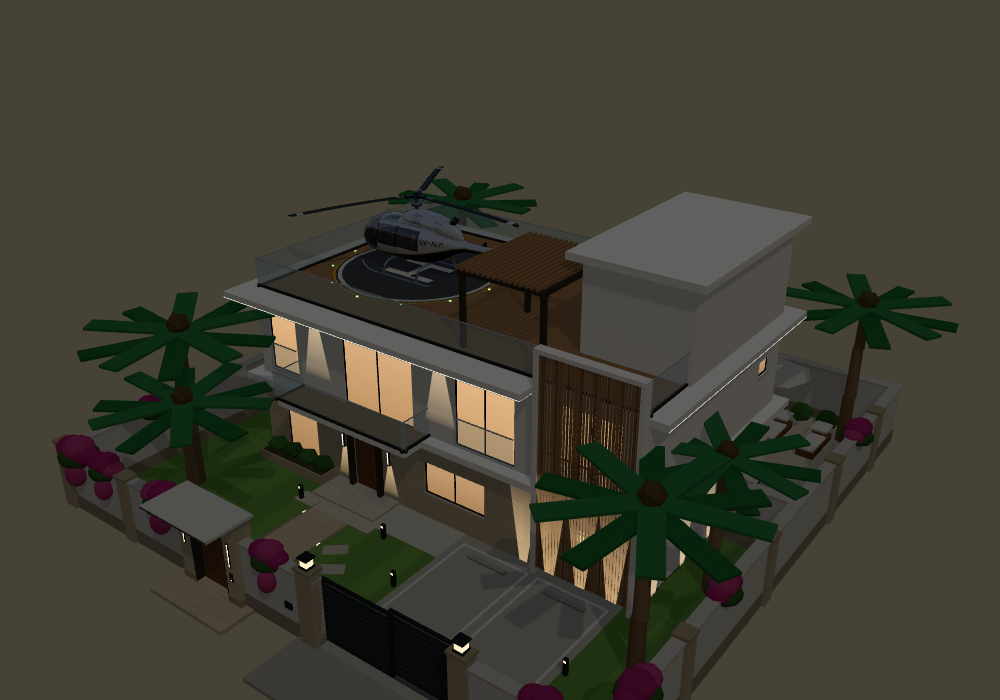 | 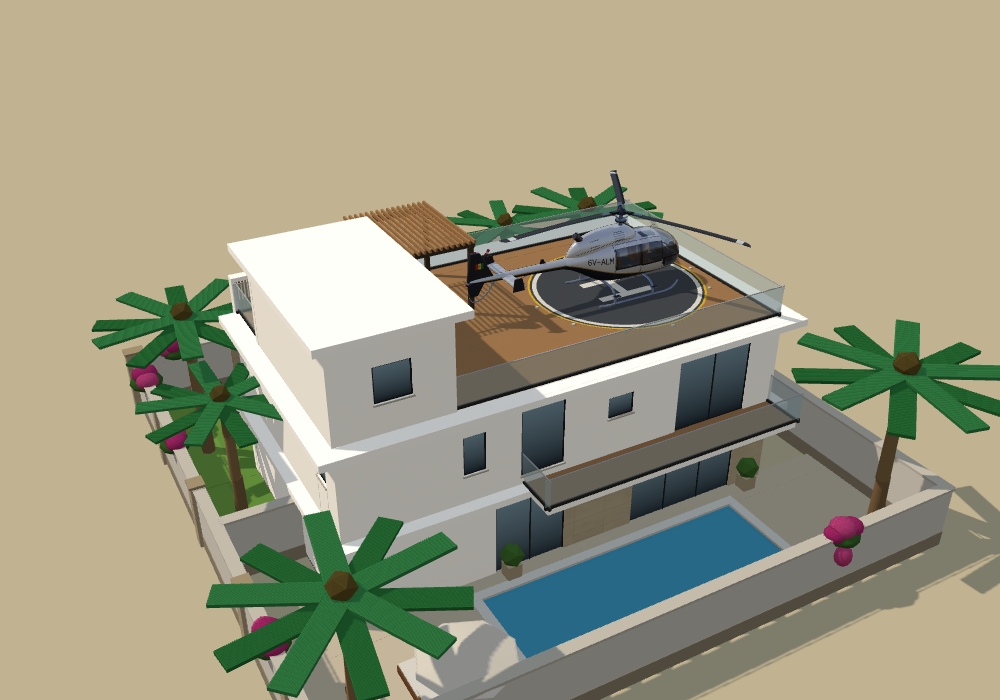 |

- **Builder:** `buildAlmadiesVilla(kit, spec)` draws into a hub's batches, as `src/world/builder.ts` hands them to the flagship. `buildAlmadiesVillaSolo(spec)` draws on its own, for the viewer and the GLB.
- **On its own:** 19 meshes, 22 250 triangles; `glb/villa.glb` (1.04 MB).
- **In the street:** it has 13 meshes of its own:
  - the car gate, 1;
  - the main entrance, 2;
  - the façade, 6;
  - the helicopter, 4 (lane R2-H's, by material).

  Everything else joins the district's merged batches. On a phone page (390 × 844, medium) the compound measured 14 draw calls (one more than its meshes: a material drawn in two passes) and 15 288 triangles in a view of the entrance (`docs/proof/ld2d/r2-entrance/cost.json`). The budget is ≤ 25.

## The spec: what each parameter changes

`AlmadiesVillaSpec`; every part left out is the flagship's (`FLAGSHIP`).

| Parameter | What it changes |
|---|---|
| `lot` | The lot's rectangle in the hub. The Almadies' lots are all 22 × 22 m (`src/world/builder.ts` `LS`). A larger lot (each side ≥ 22 m) gets a wider street wall and lawns and a deeper back garden. The gate, the entrance, the bays, the front garden and the house keep their places from the street. A smaller lot is refused. |
| `facing` | The side of the lot on the street: `south` (+z, the flagship's), `north`, `east`, `west`. The whole villa turns to face it, with its colliders, its gate's slide and its door's swing. |
| `mirror` | The villa mirrored: the car gate on the west, the main entrance on the east, the stair tower's claustra on the other side. The house number still reads the right way and the door still swings into the garden. |
| `palette` | Any colour of the compound (`COMPOUND_PALETTE`: walls, stone, gate, lawns, flowers, the entrance's travertine `clad`, teak `door`, `bronze`...). Also the house's `render` and `travertine`: the façade's vertex colours are tinted. |
| `storeys` | 1, 2 (the flagship's) or 3. The façade's first-floor band is dropped or repeated. The roof (its terrace, pergola, helipad and helicopter) moves with it, and what rises through it (the stair tower's claustra) is stretched or shortened. The house's solid box follows. The interior plan stays the flagship's three levels: another storey count is drawn in the street only. |
| `pool` | The pool in the back garden, or the deck over its place. |
| `helipad` | The pad on the roof and the helicopter on it, or a plain roof terrace. |
| `number` | The house number on the main entrance's lintel, in bronze bars. |

A variant: mirrored, three storeys, no pool, no helipad, a warmer palette, number 12. This is `VARIANT` in `scripts/export-villa-kit.mjs`: 14 meshes, 12 642 triangles.

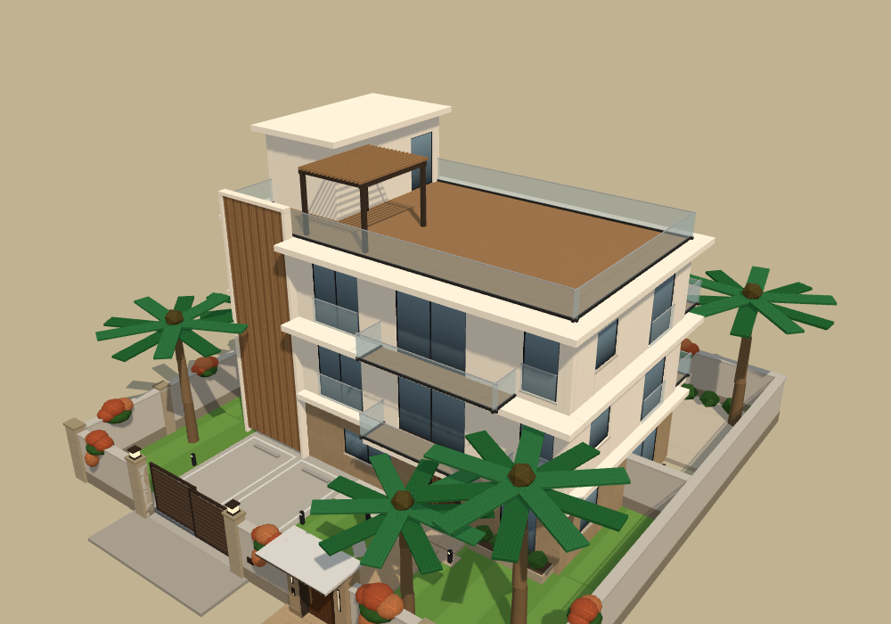

## The pieces

Each piece is built on its own at the plan's origin: the lot's centre, the street toward +z. Plan coordinates are `src/housing/villa.ts`'s.
- **Meshes and triangles:** the piece drawn on its own.
- **In the street:** what it costs the district.

| Piece | Builder | Meshes | Triangles | In the street | GLB |
|---|---|---|---|---|---|
| [Le plan (trois niveaux)](#plan) | `src/housing/villaPlan.ts VILLA_PLAN, built by src/economy/homeInterior.ts buildHomeInterior` | 46 | 27 724 | none (the interior, off the street grid) | `glb/plan.glb` (1.52 MB) |
| [La façade et ses finitions](#facade) | `src/housing/villaFacade.ts buildVillaFacade` | 6 | 4 328 | 6 draw calls (render, travertine, trims, glazing, glass, lights) | `glb/facade.glb` (281 kB) |
| [Le mur d’enceinte](#wall) | `src/world/villaCompound.ts drawBoundaryWall` | 3 | 4 470 | 0 (the district's merged batches) | `glb/wall.glb` (153 kB) |
| [Le portail coulissant (voitures)](#cargate) | `src/world/villaCompound.ts drawCarGate` | 2 | 370 | 1 draw call (its own mesh) | `glb/carGate.glb` (51 kB) |
| [L’entrée principale](#entrance) | `src/world/villaCompound.ts buildEntrance` | 4 | 536 | 2 draw calls (its travertine with the path, its door) | `glb/entrance.glb` (44 kB) |
| [Les deux places de parking](#bays) | `src/world/villaCompound.ts drawBays` | 2 | 42 | 0 (the district's merged batches) | `glb/bays.glb` (5 kB) |
| [Le jardin de devant](#frontgarden) | `src/world/villaCompound.ts drawLawns, drawFrontGarden, drawFrontPalms` | 5 | 1 224 | 0 (the district's merged batches) | `glb/frontGarden.glb` (100 kB) |
| [La piscine et sa terrasse](#pooldeck) | `src/world/villaCompound.ts drawPoolDeck` | 4 | 1 060 | 0 (the district's merged batches) | `glb/poolDeck.glb` (94 kB) |
| [La pergola du toit](#pergola) | `src/housing/villaFacade.ts buildVillaFacade` | 1 | 240 | part of the façade's trims (no draw call of its own) | `glb/pergola.glb` (20 kB) |
| [L’héliport](#helipad) | `src/housing/villaFacade.ts buildVillaFacade` | 2 | 846 | part of the façade's trims and lights (no draw call of its own) | `glb/helipad.glb` (39 kB) |
| [L’hélicoptère](#helicopter) | `src/world/helicopter.ts buildHelicopter` | 4 | 10 220 | 4 draw calls (its own meshes, by material) | `glb/helicopter.glb` (353 kB) |
| [L’ameublement (Collection Almadies)](#furniture) | `src/housing/villaLayout.ts VILLA_ALMADIES_LAYOUT` | 41 | 22 136 | none (inside; each piece its own model) | `glb/furniture.glb` (2.17 MB) |

### <a id="plan"></a>Le plan (trois niveaux) (`plan`)

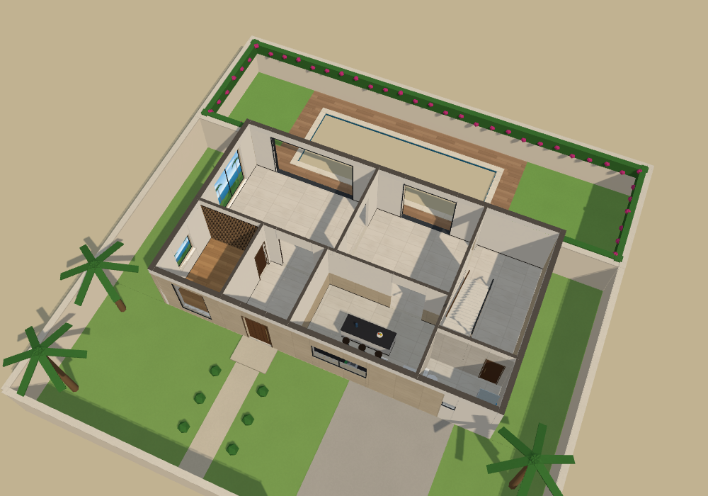

*The picture: the ground floor seen from above, its ceiling and the floors above taken off.*

- **Builder:** src/housing/villaPlan.ts VILLA_PLAN, built by src/economy/homeInterior.ts buildHomeInterior (src/housing/apartment.ts).
- **What it is:** The floor plan both the interior and the façade are drawn from: the ground floor (entrée, grand salon, salle à manger, cuisine, bureau, hall, salle d’eau, the back garden and its pool), the first floor (salon familial, suite parentale with dressing and bath, two bedrooms, bathroom, two balconies), the roof terrace (helipad, pergola, stair head); two straight flights. Its 3D form is the interior shell.
- **Parameters:**
  - `plan`: a FloorPlan (src/housing/plan.ts, version 2 with levels): rooms, openings, windows, fixtures, stairs, pergolas, marks.
- **Cost:** 46 meshes and 27 724 triangles on its own; in the street, none (the interior, off the street grid).
- **File:** `glb/plan.glb` (1.52 MB).

### <a id="facade"></a>La façade et ses finitions (`facade`)

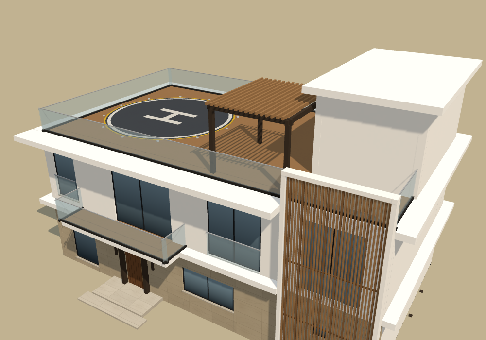

- **Builder:** src/housing/villaFacade.ts buildVillaFacade (from VILLA_PLAN); this kit's villaFacadeFor.
- **What it is:** The house seen from the street: the travertine ground floor, the ivory render above, thin white slabs, floor-to-ceiling glazing in slim dark frames, frameless glass balustrades, the oak claustra of the stair tower, the teak front door in its bronze portal, and its night lights (warm windows, uplights, the roof's line of light). Its finishes: src/housing/villaFinish.ts (travertine slabs, oak boards, the window view).
- **Parameters:**
  - `storeys`: 1, 2 or 3: the first-floor band dropped or repeated, the roof following;
  - `helipad`: the pad's marks and lights on the roof, or not;
  - `palette.render / palette.travertine`: the render's and the travertine's tones.
- **Cost:** 6 meshes and 4 328 triangles on its own; in the street, 6 draw calls (render, travertine, trims, glazing, glass, lights).
- **File:** `glb/facade.glb` (281 kB).

### <a id="wall"></a>Le mur d’enceinte (`wall`)

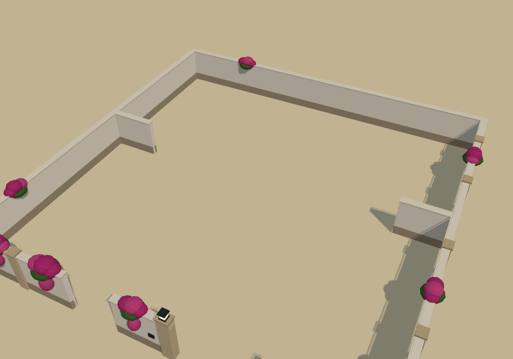

- **Builder:** src/world/villaCompound.ts drawBoundaryWall.
- **What it is:** The 2.4 m wall on the lot's four edges with its plinth and coping, broken by the car gate and the main entrance; the side strips closed from the house; travertine pillars (a big one at the corner), the gate's lantern pillars, the plaque and letter box; bougainvillea spilling over. Solid.
- **Parameters:**
  - `lot`: its edges (a larger lot: longer runs, more pillars);
  - `palette.wall / plinth / coping / stone / stoneDark / bloom / hedge`: its colours.
- **Cost:** 3 meshes and 4 470 triangles on its own; in the street, 0 (the district's merged batches).
- **File:** `glb/wall.glb` (153 kB).

### <a id="cargate"></a>Le portail coulissant (voitures) (`carGate`)

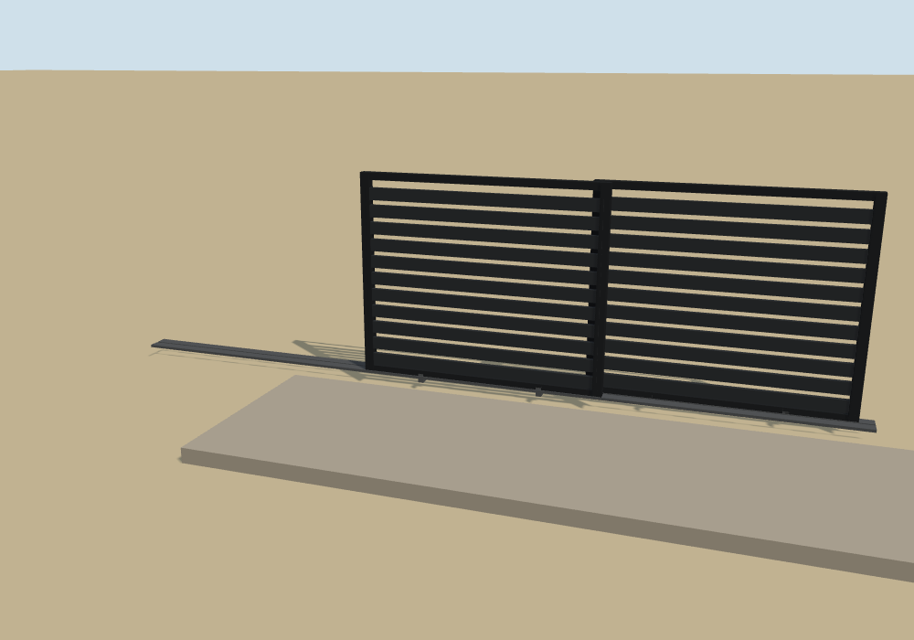

- **Builder:** src/world/villaCompound.ts drawCarGate; slideGate moves it (src/villa/module.ts).
- **What it is:** The telescopic car gate: two slatted anthracite half panels on two tracks; open, they stow between the main entrance and the gate. Its own mesh and its moving box; the dropped kerb before it and its pools of light. Opens for the villa's people (src/villa/gate.ts gateWants).
- **Parameters:**
  - `palette.frame / slat / rail / apron`: its colours;
  - `mirror`: it stows the other way.
- **Cost:** 2 meshes and 370 triangles on its own; in the street, 1 draw call (its own mesh).
- **File:** `glb/carGate.glb` (51 kB).

### <a id="entrance"></a>L’entrée principale (`entrance`)

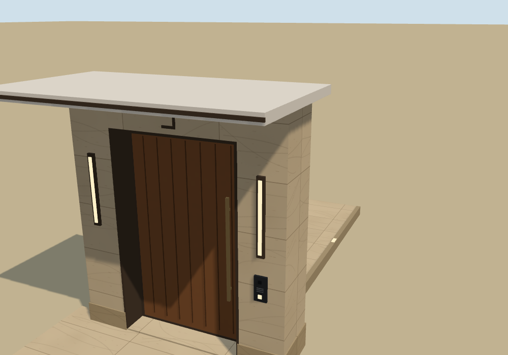

- **Builder:** src/world/villaCompound.ts buildEntrance; swingEntrance turns its door (src/villa/module.ts, the rule src/villa/gate.ts entranceWants).
- **What it is:** The main door for people, in line with the front door: a travertine portal 0.8 m above the wall, a pivoting teak and bronze door, a slim canopy with a line of light, the house number in bronze, an intercom, light bars; the straight travertine path to the forecourt, lit flush in its edges.
- **Parameters:**
  - `number`: the house number on its lintel;
  - `palette.clad / door / bronze / pull / slab`: its travertine, teak, bronze and canopy;
  - `mirror`: its door turns the other way.
- **Cost:** 4 meshes and 536 triangles on its own; in the street, 2 draw calls (its travertine with the path, its door).
- **File:** `glb/entrance.glb` (44 kB).

### <a id="bays"></a>Les deux places de parking (`bays`)

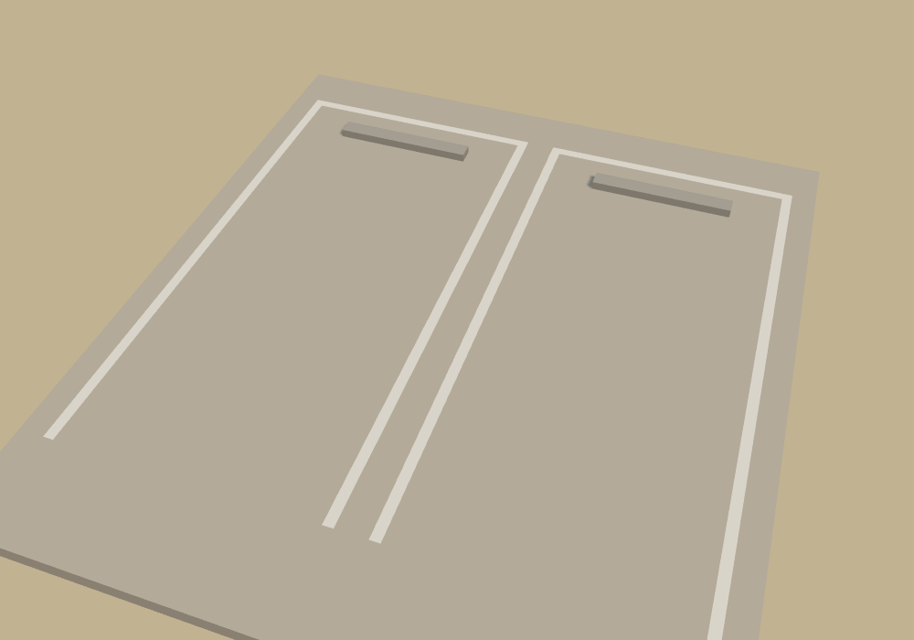

- **Builder:** src/world/villaCompound.ts drawBays (src/housing/villa.ts BAYS; « Garer à la villa »: src/villa/bays.ts).
- **What it is:** The paved driveway from the gate to the house, two marked bays of 2.6 × 5.4 m for SUVs facing the house, their wheel stops.
- **Parameters:**
  - `palette.drive / line / stop`: its colours.
- **Cost:** 2 meshes and 42 triangles on its own; in the street, 0 (the district's merged batches).
- **File:** `glb/bays.glb` (5 kB).

### <a id="frontgarden"></a>Le jardin de devant (`frontGarden`)

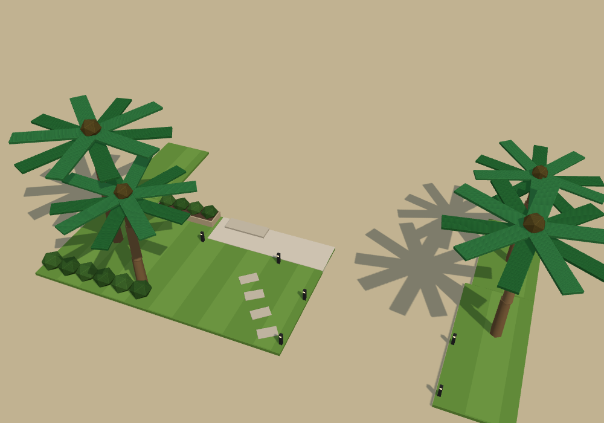

- **Builder:** src/world/villaCompound.ts drawLawns, drawFrontGarden, drawFrontPalms (drawPalm).
- **What it is:** The mown lawns, the forecourt to the front door and its step, stepping stones from the gate to the path, the planted stone bed along the house, the hedge inside the wall, garden bollards and their pools at night, four palms with uplights.
- **Parameters:**
  - `lot`: its lawns fill a larger lot;
  - `palette.lawn / lawn2 / fore / step / bed / hedge / post / bark / frond`: its colours.
- **Cost:** 5 meshes and 1 224 triangles on its own; in the street, 0 (the district's merged batches).
- **File:** `glb/frontGarden.glb` (100 kB).

### <a id="pooldeck"></a>La piscine et sa terrasse (`poolDeck`)

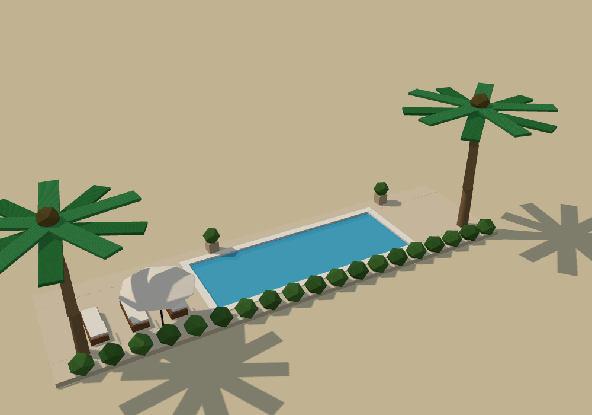

- **Builder:** src/world/villaCompound.ts drawPoolDeck (src/housing/villa.ts POOL; the swim: src/villa/swim.ts).
- **What it is:** The back garden: the deck, the 10 × 3.6 m pool with its white coping and water (lit at night), three teak loungers and a parasol, potted plants, the back hedge, two palms in the corners.
- **Parameters:**
  - `pool`: the pool, or the deck over its place;
  - `lot`: a deeper lot: a deeper deck;
  - `palette.deck / rim / water / teak / cushion`: its colours.
- **Cost:** 4 meshes and 1 060 triangles on its own; in the street, 0 (the district's merged batches).
- **File:** `glb/poolDeck.glb` (94 kB).

### <a id="pergola"></a>La pergola du toit (`pergola`)

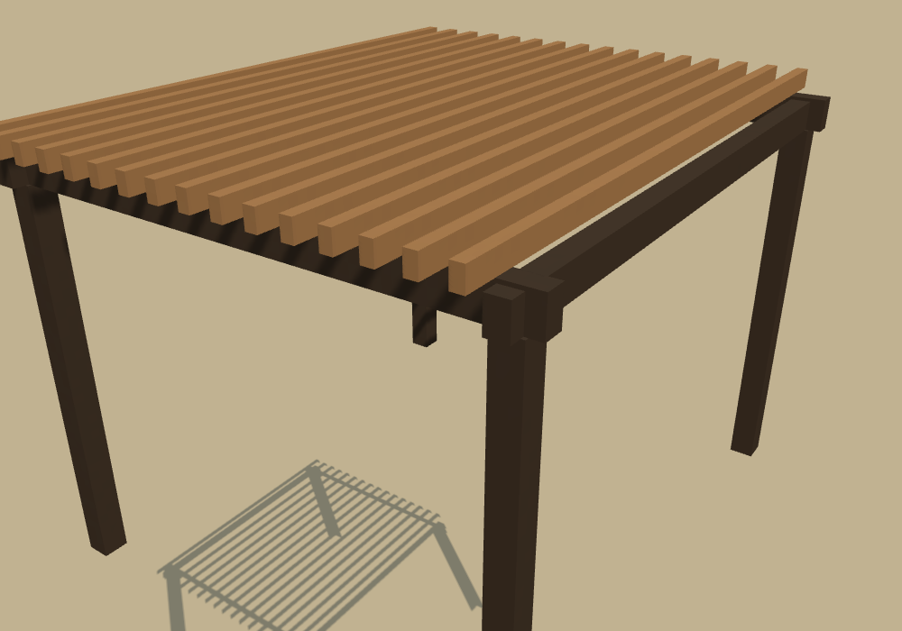

- **Builder:** src/housing/villaFacade.ts buildVillaFacade (VILLA_PLAN.pergolas), cut out of the façade.
- **What it is:** Over the roof terrace's street corner: oak slats on two dark bronze beams, on four posts, 2.7 m above the deck.
- **Parameters:**
  - `plan.pergolas`: where and how high (src/housing/villaPlan.ts).
- **Cost:** 1 meshes and 240 triangles on its own; in the street, part of the façade's trims (no draw call of its own).
- **File:** `glb/pergola.glb` (20 kB).

### <a id="helipad"></a>L’héliport (`helipad`)


- **Builder:** src/housing/villaFacade.ts buildVillaFacade (src/housing/villa.ts HELIPAD), cut out of the façade.
- **What it is:** On the roof: a dark disc 6.4 m across, a white ring, a yellow edge, the H (its uprights along the helicopter), twelve lights round it (green and yellow, lit at night).
- **Parameters:**
  - `helipad`: on the roof or not;
  - `HELIPAD`: its centre and radius.
- **Cost:** 2 meshes and 846 triangles on its own; in the street, part of the façade's trims and lights (no draw call of its own).
- **File:** `glb/helipad.glb` (39 kB).

### <a id="helicopter"></a>L’hélicoptère (`helicopter`)

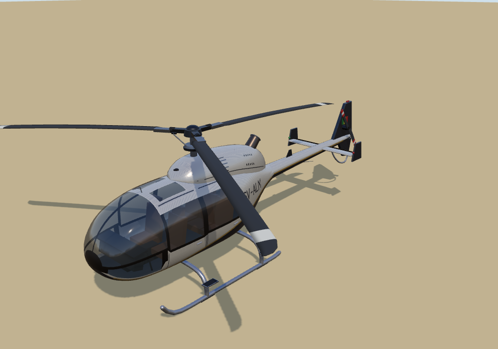

- **Builder:** src/world/helicopter.ts buildHelicopter (lane R2-H's).
- **What it is:** Lane R2-H's light single-engine helicopter (no maker's model): its sculpted cabin under tinted glazing, a three-blade rotor, skids, a Senegalese registration; parked on the pad along the roof terrace (HELIPAD.yaw).
- **Parameters:**
  - `helipad`: on its pad or not;
  - `HELIPAD.yaw`: its heading on the pad.
- **Cost:** 4 meshes and 10 220 triangles on its own; in the street, 4 draw calls (its own meshes, by material).
- **File:** `glb/helicopter.glb` (353 kB).

### <a id="furniture"></a>L’ameublement (Collection Almadies) (`furniture`)

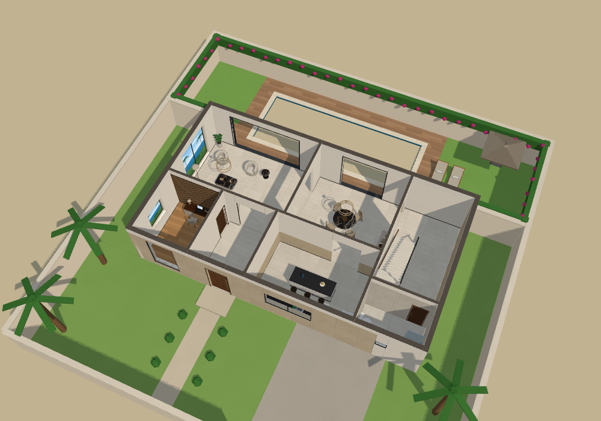

*The picture: the ground floor's pieces in the ground floor's shell (the file holds the three levels' pieces, without the shell).*

- **Builder:** src/housing/villaLayout.ts VILLA_ALMADIES_LAYOUT; the models src/economy/furnitureModels.ts furnitureModel (the kit: src/world/furnitureKit.ts).
- **What it is:** The villa furnished room by room on its three levels (the grand salon, the dining room, the study, the entrance, the suite, the bedrooms, the family lounge, the pool deck, the roof terrace): one plain list of catalogue pieces and their spots, each valid by the home editor's rules.
- **Parameters:**
  - `layout`: the list: catalogue id, room, x, z (plan space), quarter turns.
- **Cost:** 41 meshes and 22 136 triangles on its own; in the street, none (inside; each piece its own model).
- **File:** `glb/furniture.glb` (2.17 MB).

### The finishes' textures

The villa's own finishes (`src/housing/villaFinish.ts`) are drawn in code and sampled in world space by the materials. As PNG files in `docs/kits/almadies-villa/finishes/`:

| `stoneTiles` (2.4 m a repeat) | `oakPlanks` (2.4 m a repeat) | `windowView` |
|---|---|---|
| 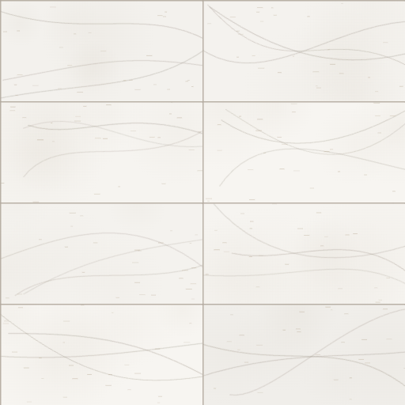 | 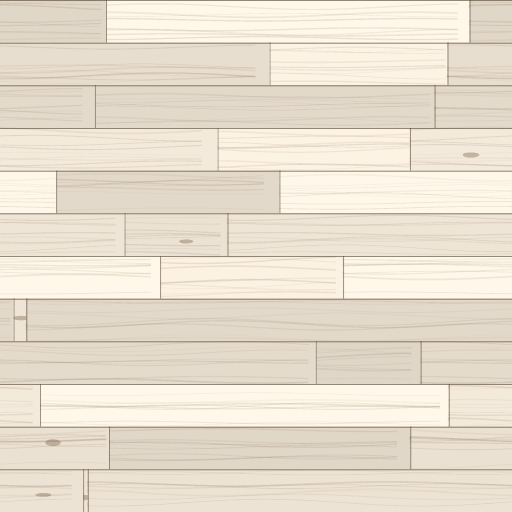 | 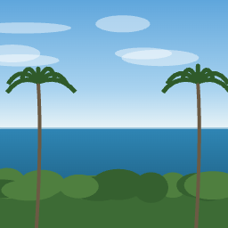 |

- `stoneTiles`: 120 × 60 cm slabs of cream marble and travertine, tinted per use (the façade's travertine, the floors, the bathrooms).
- `oakPlanks`: 20 cm oak boards, tinted darker for the teak decks.
- `windowView`: the view through the windows.

## Placing the villa on another lot

1. **Draw it.** `src/world/builder.ts` draws the flagship after the streets are dressed, so that its own random draws are made unseen and the rest of the district stays as it was. It does the same on another lot `L = lotRect(i, j, a, b)`. The street is on `lotFaces(a, b)[1][1]`: +1 is south, −1 is north. The corner's side street is on `a`: 1 is east, 0 is west.

   ```ts
   import { buildAlmadiesVilla } from '../kits/almadiesVilla';
   // in place of genericVilla(L, faces) for that lot (draw the generic villa's random numbers unseen first: dryRun, as for the flagship)
   const v = buildAlmadiesVilla({ lite, plain, pave, leaves, trunks, water, bulbs: lampBulbs, metalMat, pool }, {
     lot: { x0: L.x0, x1: L.x1, z0: L.z0, z1: L.z1 }, facing: faces[1][1] > 0 ? 'south' : 'north', mirror: a === 0, number: '7',
     palette: { render: 0xf3ead9 }, storeys: 2, pool: true, helipad: false,
   });
   group.add(v.group); colliders.push(...v.colliders); canopies.push(...v.canopies); keepClear.push(...v.keepClear);
   ```

   `v.lot` is the lot. `v.gate` and `v.entrance` are the gate's and the door's rigs: meshes, boxes, the opening. `v.group.userData.gate` and `v.group.userData.entrance` hold them for the villa module.

2. **Its life.** `src/villa/module.ts` finds the flagship's compound by its name (`villa-compound`) in the Almadies. For another villa it would look up that villa's group and its own home id:
   - the gate's and the door's rules are `src/villa/gate.ts` `gateWants` and `entranceWants`, in plan coordinates;
   - `slideGate` and `swingEntrance` move any frame's gate and door;
   - the module's update of the gate's box assumes the flagship's frame (the box's east edge follows the panels). A turned or mirrored lot needs the same in its frame. This is the one piece of the next step's wiring.
3. **The home.** Add a catalogue entry (`src/economy/catalog.ts`) and its door, board and directory entry (`src/economy/estate.ts` `VILLA_GATES`). The interior can reuse `VILLA_PLAN` (`src/housing/villaPlan.ts`); for a mirrored villa the plan would be mirrored too, which is not in this kit. The furniture can reuse `VILLA_ALMADIES_LAYOUT`.
4. **The street.** The villa keeps the pavement before its gate and its entrance open (`keepClear`). The street dressing (`src/game/streetDress.ts`) and the parked cars then draw around them. As with the flagship, check the street dressing, the mall's walk (`npm run check:city`) and the lot digest test.

## The GLB files

- **What they hold:**
  - every mesh of a piece, with its vertex colours;
  - vertices shared where they can be;
  - no texture coordinates where no texture reads them;
  - the interior's and the furniture's textures embedded.

  The game's own shader touches are not in the files: the grain and the travertine and oak detail maps (`src/world/grain.ts`). A material is exported for its colours. The façade's night lights (additive in the game) are exported lit.
- **The total is 5.84 MB**, against a limit of about 10 MB.
- **To make them again** (in the browser, through Playwright: three's GLTFExporter needs FileReader):
  - `node scripts/export-villa-kit.mjs` makes all the pieces, the whole villa and the variant;
  - `node scripts/export-villa-kit.mjs --only helicopter,villa,variant` makes only these, for example once lane R2-H's helicopter is merged (the villa's file holds it too). The other pieces' numbers are kept from `kit.json`.
