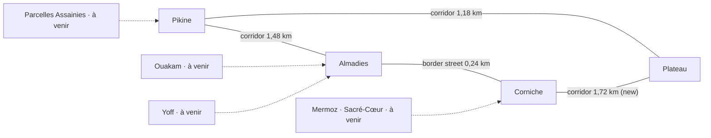

# The road network: four districts, one connected graph

Branch `feature/driving-2-20261021` (from PR #59, `feature/maplibre-corridor-20261020`). The roads themselves: `CORRIDOR.md`. Map data and what is approximate: `PROVENANCE.md`.

## The graph

Solid edges are drivable today; dotted ones are the *intended* neighbours of the planned districts, not roads (there is no edge, so nothing routes through them and no player is offered a way in).

It is a ring, not a star: Pikine is only one of four equal nodes. Centre-to-centre driving distances (game metres, from `src/road/graph.ts`):

| Trip | Route chosen | Metres |
|---|---|---|
| Pikine → Almadies | direct corridor | 1 731 |
| Pikine → Plateau | direct corridor | 1 429 |
| Almadies → Corniche | border street | 240 |
| Corniche → Plateau | direct corridor (new) | 1 974 |
| Corniche → Pikine | Corniche → Almadies → Pikine | 1 971 |
| Almadies → Plateau | Almadies → Corniche → Plateau | 2 214 |

Every playable district reaches every other (`connected()`), in both directions. A route never "returns to Pikine" to reach somewhere else: Dijkstra over the edges, nothing hard-wired.

## How a trip works

* **One mechanism for every segment.** A corridor (`RouteDef` in `src/road/routes.ts`) and a border street (a `LINKS` entry in `src/transport/hubLink.ts`) are both edges; the swap, the vehicle carry, the staged build-ahead and the save are the same code for both. The border street used to cross with a loading hand-over; it now builds the district beyond ahead of the player (`approachLink`, prewarmed with the same 4 ms slices) and swaps without a stop.
* **The vehicle is the same vehicle on every leg.** The owned vehicle is recorded as it crosses (uid, paint, condition), re-seated in the next frame, and saved parked in whichever district it stands in. A save made in Corniche, Almadies' south street or the Plateau loads there with the vehicle (`tests` + `check-corridor.mjs`).
* **Frames close.** Each district's frame differs from its neighbour's by a translation; the four translations around the ring add up to zero (`graph.test.ts`), so a long trip has no drift and the map positions agree whichever district's frame is read.
* **The city map reads the graph.** The district card says « Au volant · km · via X » from `planTrip`, the route is drawn over the corridors, and the planned districts are on the map, dimmed, « À venir », with no road.

## Adding a district (Ouakam, Yoff, Parcelles Assainies, Mermoz · Sacré-Cœur)

A checklist: each item is one file, none of them an engine change.

1. Build the world: a `HubId`, its builder, its modules, its anchor in `src/geo/anchors.ts` (`HUB_ANCHORS`). Follow the Neighborhood DNA direction for its look; the network does not decide how a neighbourhood looks.
2. In `CITY_HUBS` (`src/road/graph.ts`) flip its entry from `planned` to `playable`. Until then it is on the map as « À venir » and has no edge.
3. Give it a road: a `RouteDef` in `src/road/routes.ts` (nodes, mouths with matching headings, anchors, junctions, roadside profile, a swap point on a plain stretch; add `condensed` if the real distance is short), or a border link in `hubLink.ts` if it touches a district.
4. Close the ring: choose the new district's frame so the translations around every cycle still add to zero (`graph.test.ts` fails if not).
5. Nothing else: the host streams the road, traffic and street life follow the profile, the swap, the carry, the staging, the map layer, the routing and `planTrip` follow from the data. Add its line to the table in `scripts/check-corridor.mjs` (`ROAD=<id>`).

A planned district is never marked drivable until steps 1–3 are done: `isPlayable()` is what routing, the map and the strip consult.

## What is approximate

The new Corniche ↔ Plateau alignment is hand-placed like the others (Fann → Gueule Tapée along the coast): in the right order and the right part of town, **not surveyed and not extracted from OpenStreetMap**. It is also only condensed about 1,2 : 1 against the real distance (the real Corniche and Plateau are close; the ring has to close with the other two roads, which are condensed 9 : 1), so on the map its drawn length is truthful while a driver covers about 1,7 km. The OSM extraction has still not been run on real data (see PROVENANCE §6).
